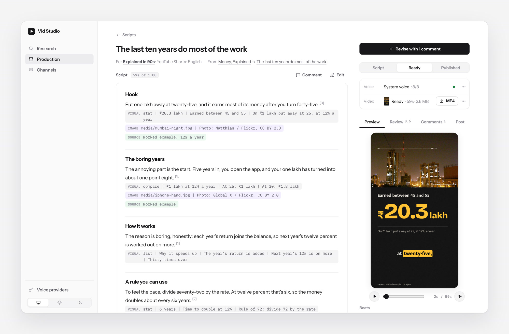
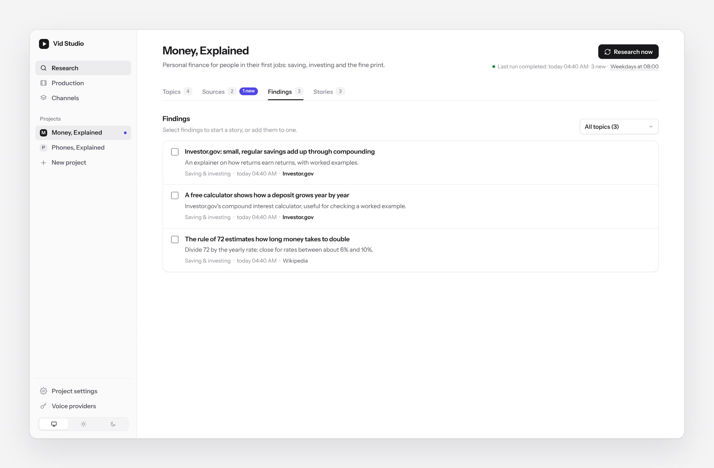
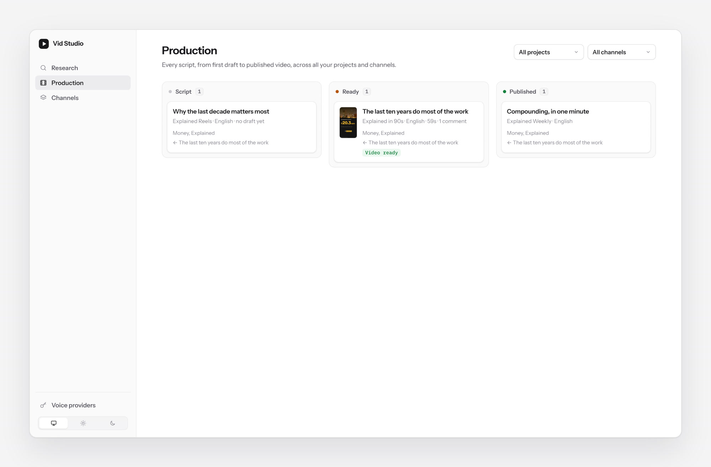
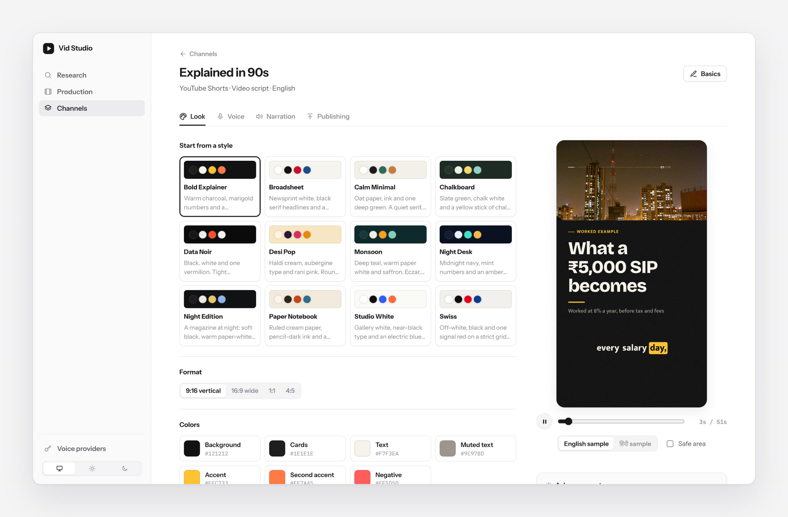
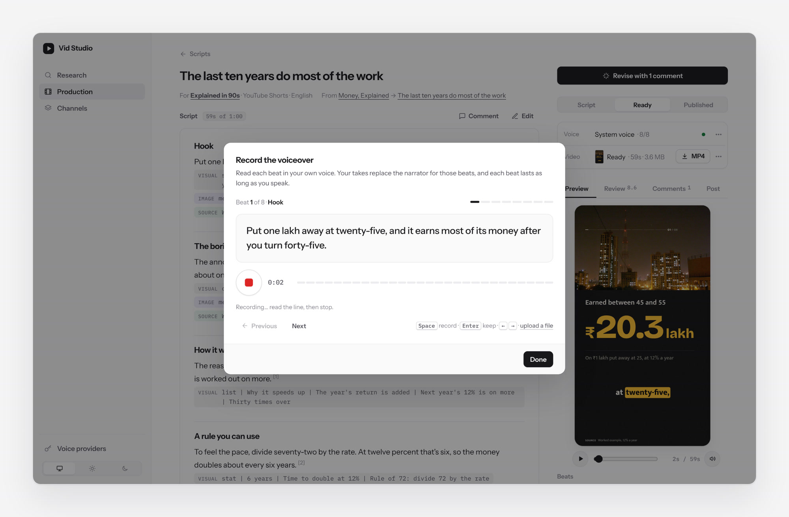
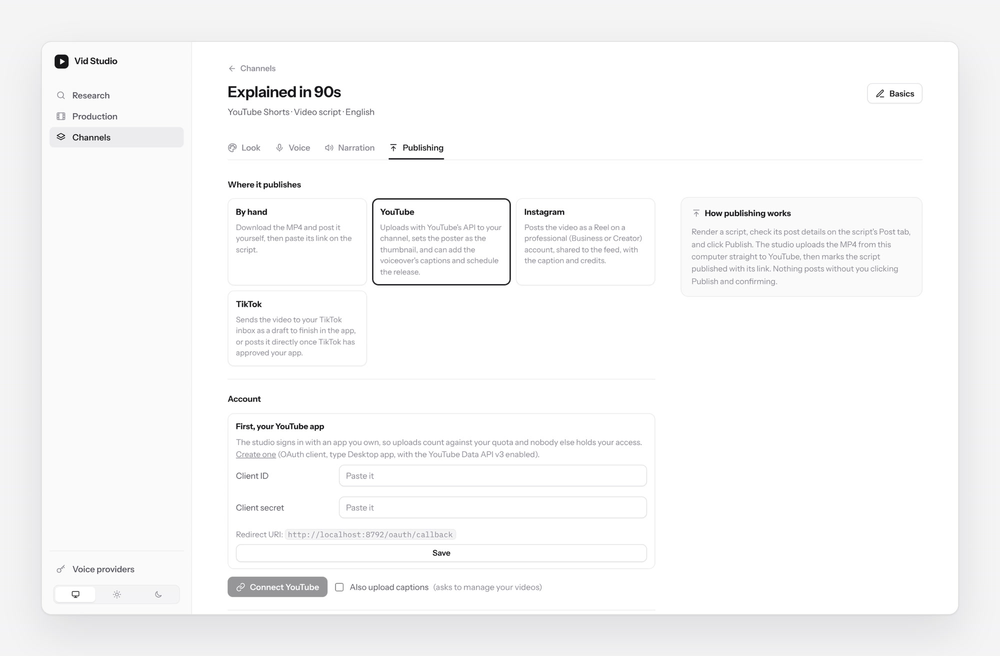
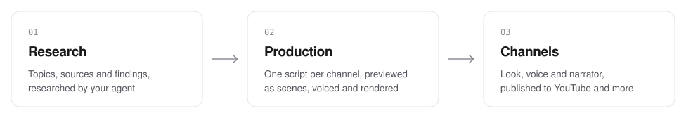

# Vid Studio

Research, write, voice and publish short explainer videos with your AI agent. Everything lives in a folder on your computer, you work in a small local studio, and videos render on your own machine.

<picture>
  <source media="(prefers-color-scheme: dark)" srcset="docs/readme/script-dark.jpg">
  
</picture>

```sh
npx skills add namanbnsl/vid-studio
```

Then ask your agent: *"Use vid-studio to set up my project."* It works with any agent that supports [skills](https://skills.sh/), such as Claude, ChatGPT or Codex.

## Research

A project follows a subject: say, plumbing products or Indian tech news. You give it **topics** and the **sources** it must check. On each run, your agent checks every source and searches the web, and brings back short **findings**, each linked to the pages it came from. Pick the findings worth a video and turn them into a **story**; your agent researches it once, in depth, for every script that follows. Research can run on a schedule.



## Write

A story becomes one **script** per channel, written in that channel's language (English, Hindi or Hinglish) and voice. Scripts are written as beats: what's said, and what's shown on screen (a number, a chart, a comparison, a quote, a photo). Your agent finds openly licensed photos for the beats about real things (credited on screen), drafts several hooks, and scores its own draft; you comment on any passage for it to fix. Production keeps every script on one board, from draft to published.



## Produce

Each **channel** has a look (twelve styles to start from, then colours, fonts with Hindi support, motion and captions), a writing voice, and a **narrator**. The narrator can be a voice on your computer, ElevenLabs, Sarvam AI, Gemini 3.8 Flash TTS, OpenAI or Google Cloud, or you: record each beat in the studio's teleprompter, or clone your voice. Every beat then lasts as long as its voice, captions follow the words, and the MP4 renders on your machine with Chrome and ffmpeg.





## Publish

Connect a channel to its YouTube channel, Instagram professional account or TikTok account, and publish from the script page. You set the title, caption, visibility and release time; the studio uploads the MP4 with each platform's official API and adds the sources and photo credits. Nothing goes out until you click Publish and confirm.



## How it works

<picture>
  <source media="(prefers-color-scheme: dark)" srcset="docs/readme/flow-dark.svg">
  
</picture>

Research stays reusable: one story can become an English Short, a Hinglish Reel and a Hindi WhatsApp post. Your agent does the thinking work (research, stories, scripts, revisions), and the studio shows you the results as soon as they land. Where a step needs your agent, the studio has a button that copies the prompt.

The workspace is plain JSON and Markdown in `~/vid-studio` (or `$VID_STUDIO_HOME`), one folder per project, so it's easy to read, back up or edit by hand. API keys and account tokens are kept in `.secrets.json` in that folder, readable only by you.

## Requirements

- Python 3.10 or newer. The studio uses only the standard library.
- Google Chrome (or Chromium) and ffmpeg, to render MP4s and convert recordings.
- Optional: an API key for a cloud voice (ElevenLabs, Sarvam AI, Gemini, OpenAI, Google Cloud); `espeak-ng` or [Piper](https://github.com/OHF-Voice/piper1-gpl) for free voices on your computer; your own Google Cloud or TikTok app, or an Instagram token, to publish.

## Files

```
skills/vid-studio/
  SKILL.md               entry point for your agent
  references/            setup, research, stories, writing, script craft, scenes, images,
                         look, narration, publishing, schedules
  scripts/studio.py      command line and local web server
  scripts/narration.py   text-to-speech providers and your own recordings
  scripts/publish.py     YouTube, Instagram and TikTok publishing
  scripts/render.py      MP4 renderer (drives Chrome and ffmpeg)
  assets/                workspace templates, the studio UI, the scene engine, example scripts
```

`studio.py --help` lists every command. Your agent uses the same commands the studio does, so anything you can do in the UI, it can do too.

## Develop

```sh
python3 dev.py demo              # a throwaway studio with sample data, opened in your browser
python3 dev.py sandbox --seed    # a test project at ../vid-studio-sandbox, with the skill linked
python3 dev.py try setup         # run Claude Code headlessly in the sandbox (setup, research, story, draft, status)
python3 dev.py reset --yes       # wipe the sandbox's studio data
python3 -m unittest discover tests
node --test tests/test_ui.js tests/test_engine.js
```

The sandbox links the skill instead of copying it, so edits apply on the next prompt. Its data stays in the sandbox, so your real `~/vid-studio` is never touched. Design notes for larger changes are in [`docs/`](docs).
