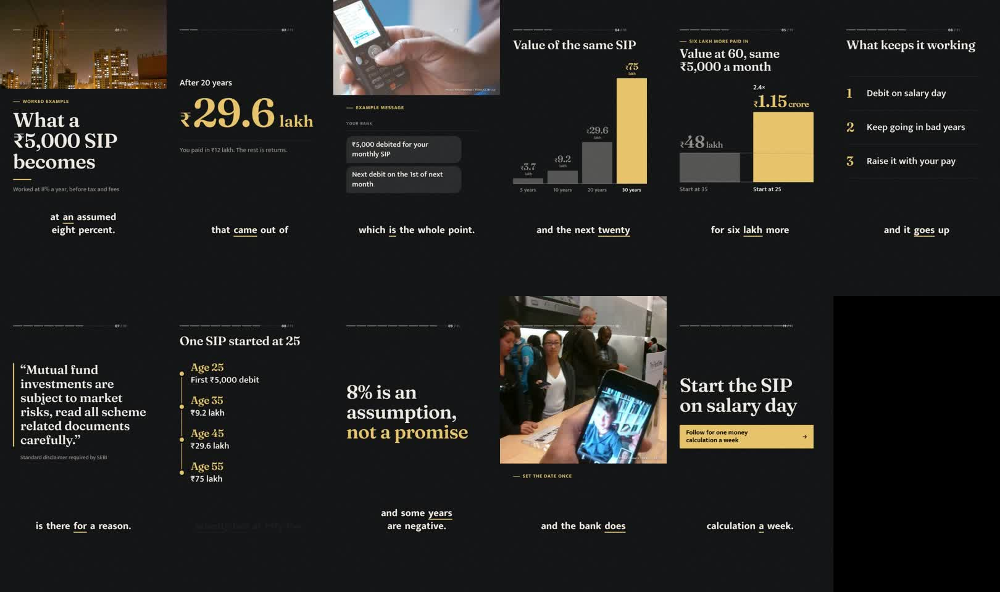
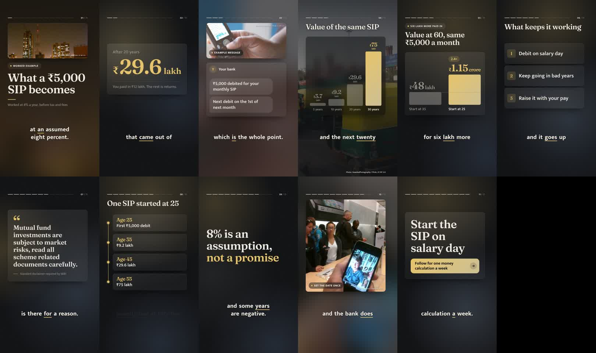
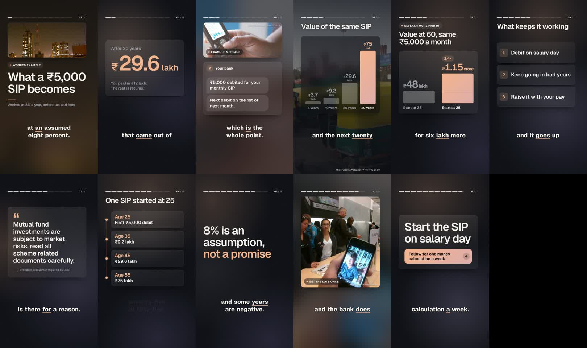
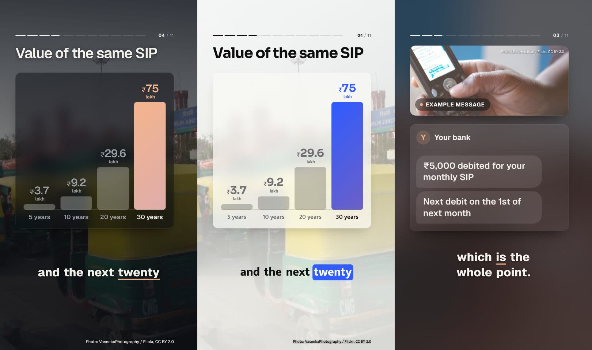
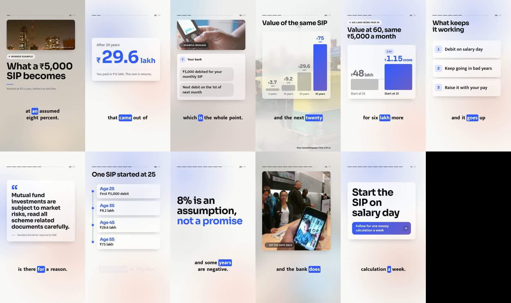
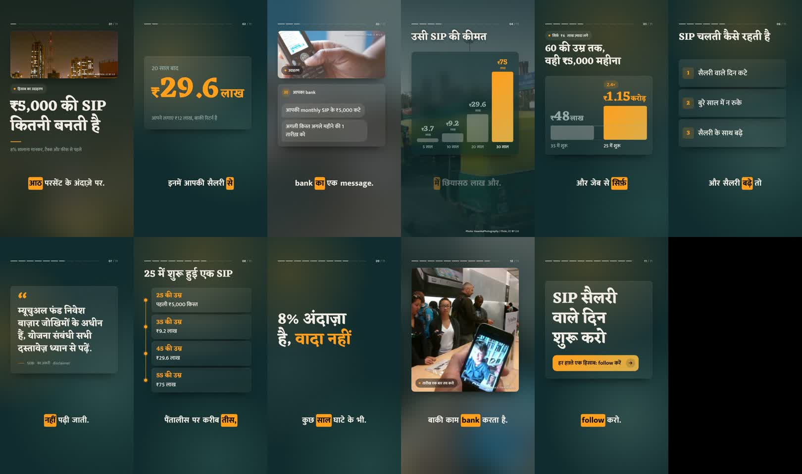
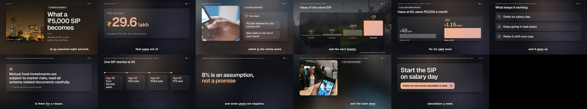

# Glass cards

The flat editorial scenes read as slides: a heading, a few lines of type and a lot of empty frame. Photos ran as hard-edged strips across the top, or sat behind charts under an 86% scrim that turned them to mud. This change gives every scene a component and every photo a frame.

## Before and after

Night Edition, the same sample script, frame for frame. Before:

After, with glass cards and the aura background:

Frost, the new house look (ink blue, peach and lilac, Geist for headlines and labels alike):

## What changed

**One card per idea.** A stat and its context sit on one rounded pane. A chart sits on one pane. Each list point and each timeline date gets a row card. A compare of two phrases is two cards with a small arrow from the first to the second. A quote sits under a large opening mark. A message is a chat thread with the sender's initial in an avatar. The end card has a pill-shaped call to action. Labels (`Text:` and kickers) are small pills with a dot.

**Glass that stays quiet.** The pane is a faint tint of the text colour with a hairline edge lit from the top and one long soft shadow. It only blurs what is behind it when that is a sharp photo; over the aura it is a clean tint. That keeps rendering at about 74 ms a frame against 61 for flat (blurring every card cost 131).

**Aura.** A new background style: three soft fields of light in `accent`, `accent2` and the text colour. They glide to new places at each scene change and hold still while a scene plays, so the glass always has something behind it.

**Photos.** A photo above a scene is now a rounded photo card, with the scene's label set on its bottom-left corner so the content below keeps its full size. The image scene's photo takes the whole space. The card sits in front of the same photo blurred and veiled, so the whole frame takes its colours from the picture. The blur is drawn once into a small canvas, so it costs nothing per frame. Full-screen photos behind charts are veiled from the top and bottom and blurred where the chart's card covers them, with the card tinted from the background colour so muted values stay readable.

## It works in every look

Light (Studio White):

Hindi (Monsoon):

Wide (Frost at 16:9):

## Settings

- `cards.style`: `glass` (default), `solid` (panes filled with `surface`), or `flat` (the old editorial look, no panes). In the studio: Channels → a channel → Look → Background & shape → Cards.
- `background.style`: new value `aura`, now the default.
- `radius`: now the card radius; bars, tiles and pills scale from it. Default 28.

Presets: Frost is new. Most presets moved to glass cards on the aura with radius 22 to 34. Clean Newsroom and Paper Notebook use solid cards. Swiss stays flat, square and strict, so the editorial look is one click away.
