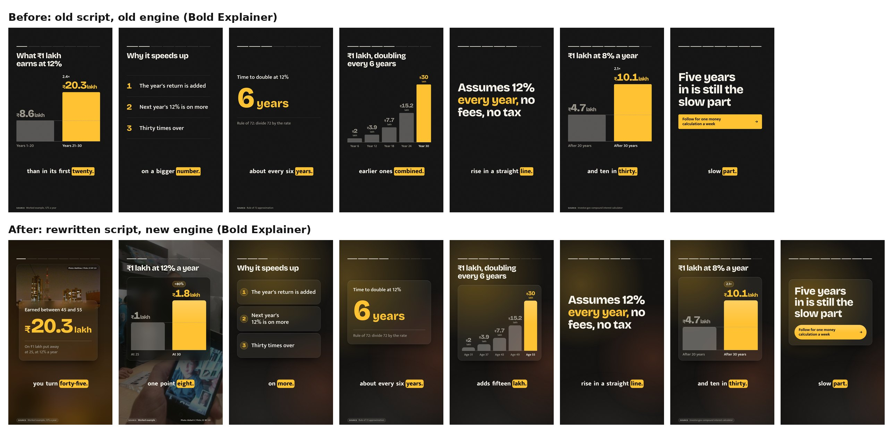
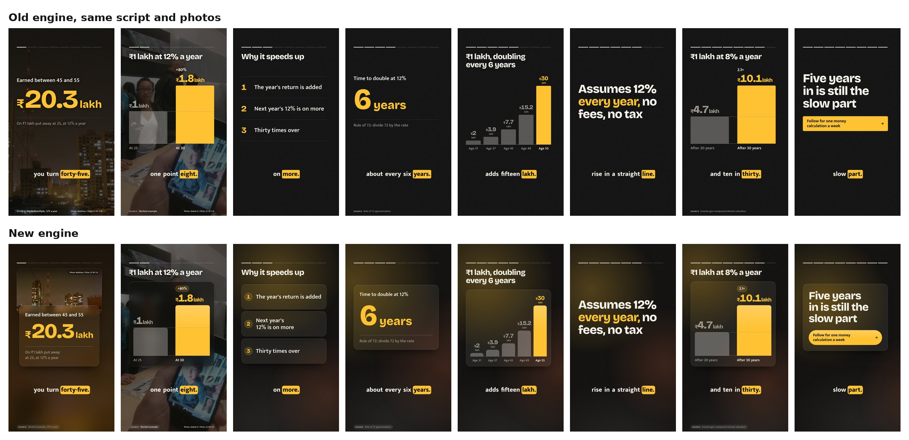
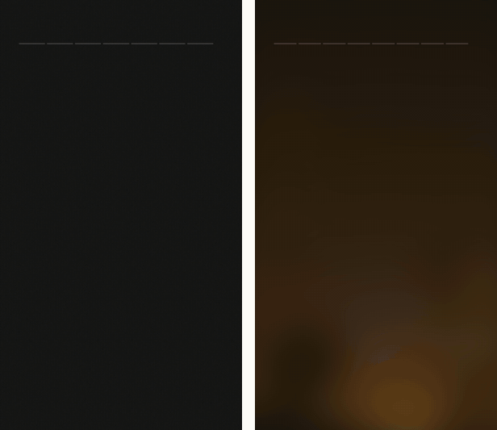
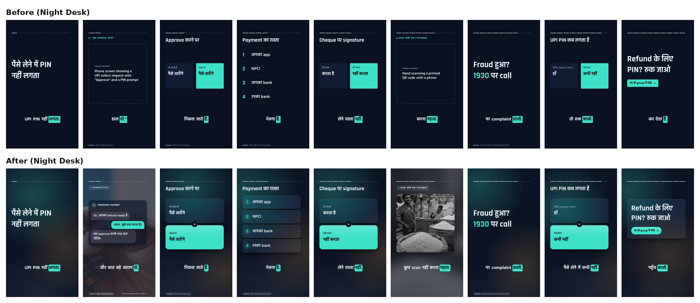
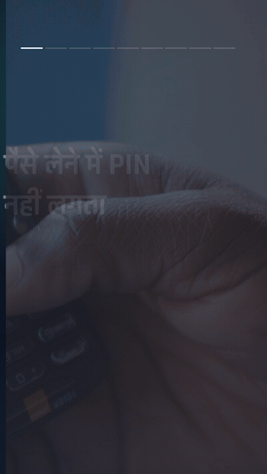
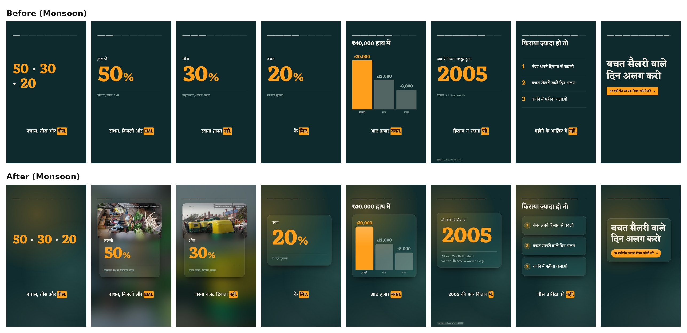
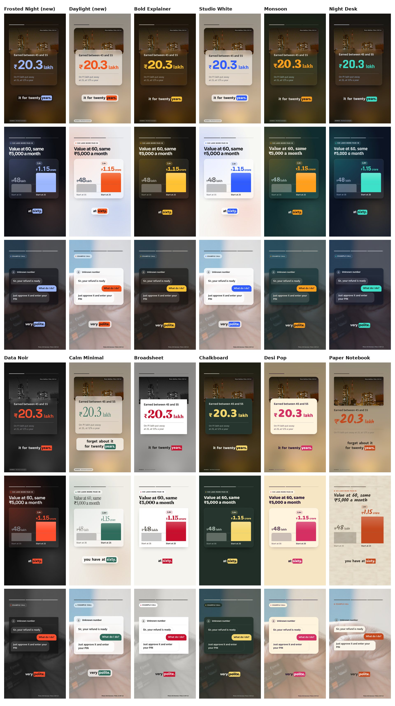
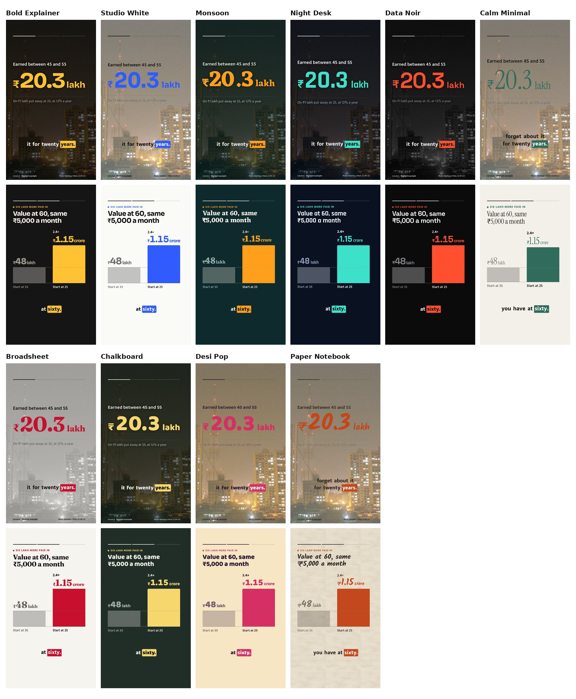
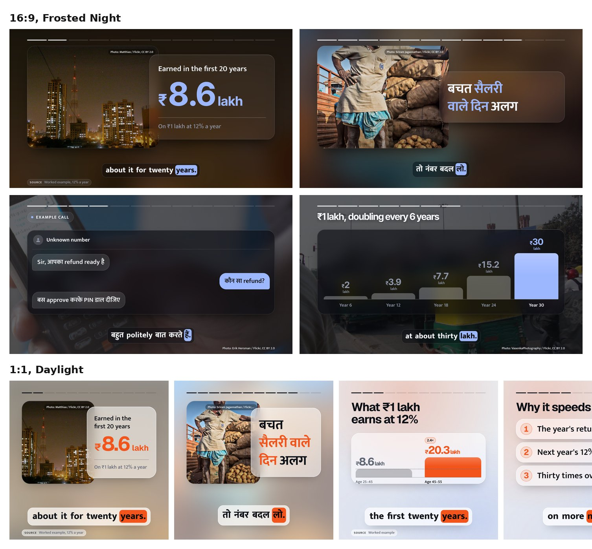
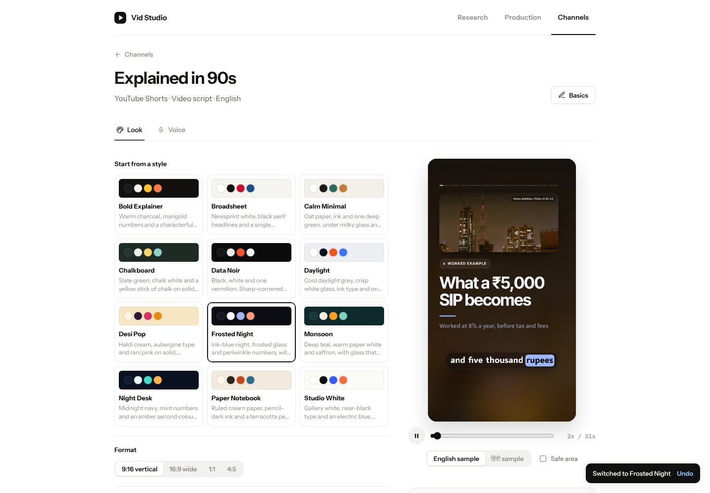

# Human stories, premium scenes

The videos were accurate and clean, but they still felt made by a machine. The scripts explained topics rather than telling anyone's story, and the frames were flat panels of type with a band of empty space under the content. This change works on both, from the research step to the rendered frame.

- **Content:** research and story notes now gather the people a story lands on, the everyday moment they meet it, and what they actually ask. Scripts are about someone, carry a point of view the evidence earns, and are scored and linted for it.
- **Design:** frosted glass panels over ambient light, real photos framed like a magazine with a blurred copy behind them, scenes that fill the frame, a new scene for the call or text a story turns on, and twelve retuned looks, two of them new.

Every image below was rendered by the real scene engine at 1080×1920 (or 1920×1080 and 1080×1080). "Before" is `main`'s engine, presets and examples; "after" is this branch.

## Before and after

### English example (Bold Explainer)



### Same script, same photos: the engine alone

The rewritten English script rendered on `main`'s engine, then on the new one. The difference here is design only.



### Motion: the first 15 seconds

Old on the left, new on the right. The photo drifts inside its frame, the panel rises over it, and the ambient light moves a little at each beat.



### Hinglish example (Night Desk)



The call the story turns on is now on screen, as a labelled reconstruction. The bubbles arrive one by one, each after a moment of typing dots, and the photo of a hand on a phone sits blurred behind the glass:



### Hindi example (Monsoon)



## What changed in the writing

The three bundled examples set the bar every agent reads before drafting, so they were rewritten around a person and a moment. The facts, citations and arithmetic are unchanged, and all three are within ±10% of their target length with no lint warnings.

| | Before | After |
|---|---|---|
| English hook | "One lakh at twelve percent earns more in its last ten years than in its first twenty." | "Put one lakh away at twenty-five, and it earns most of its money after you turn forty-five." Then the moment that makes people quit: "Five years in, you open the app, and your one lakh has turned into about one point eight." |
| English view | (none) | "The reason is boring, honestly." "I picked twelve percent to keep the maths clean." |
| Hinglish stakes | "Call आता है: 'Sir, refund भेज दिया है, बस approve करके PIN डाल दो.'" | "मान लो पापा के phone पर call आता है. आवाज़ बिल्कुल bank वाली, और बात बड़े आराम से." The call is shown as a `message` scene, and the trap and the payoff come back to पापा. |
| Hinglish end | "ये Reel उसे भेजो जो हर refund approve कर देता है." | "ये Reel घर के group में भेज दो. Scammer से पहले आप पहुँच जाओ." |
| Hindi hook | "बजट के लिए स्प्रेडशीट नहीं चाहिए, बस तीन नंबर याद रखो…" | "सैलरी बीस तारीख़ तक ख़त्म? स्प्रेडशीट नहीं चाहिए, बस तीन नंबर याद रखो…" |
| Hindi history | "ये नियम 2005 की एक किताब से मशहूर हुआ…" | "ये नियम एक माँ और बेटी ने लिखा था, Elizabeth Warren और Amelia Warren Tyagi ने…" (true, and from the cited source) |

### Upstream, where the human material comes from

A writer can't invent a real person or moment at draft time, and must not. So the change starts in research:

- **`research.md`** reads the feed the way the audience would. Every finding says who it lands on, and runs listen to where the audience talks (forums, comment threads, complaint sites, help pages) for leads to follow to citable pages. Findings are written "like a person telling a colleague", not a press release.
- **`story.md`** has a new section, "Research the people, not just the facts", and a fixed shape for notes: angle, the people (real cases, who decided it, who disagrees), the moment, what people believe and ask (in their words), the facts, numbers, tension, what the viewer can do, exact quotes, and pictures to find.
- **`setup.md`** asks who's talking on each channel and saves it as the persona; topics are described from the audience's side.

### Script craft

- **New §3, "The person and the moment":** choose who the video is about (a sourced case, the viewer in a moment, an openly hypothetical relative, or the decision-maker), carry them through to the payoff, put the viewer somewhere specific, have a point of view the facts earn, never fake experience, and respect the viewer.
- **A `moment` hook style** ("It's the twentieth, and your salary account says three thousand"), plus new re-hooks (returning to the person) and new machine-made patterns: invented characters, fake anecdotes, lecture voice, talking to a crowd, "Imagine…" openers, mock suspense.
- **A ninth rubric score, `human`** ("Human story" in the studio), next to `natural` ("Sounds human"). It asks whether the video is about someone, carried through, with a lived detail and an earned view.
- The default voice, the default video format and `SKILL.md` carry the same rule: real cases, the viewer, or openly hypothetical people, never invented ones.

### The linter catches it

`studio.py scenes` now flags invented characters, fake anecdotes, "not X, it's Y" reframes, em-dash piles, talking to "guys", sentence rhythm that never varies, a video of 30 seconds or more with no photos, and a message that isn't labelled as an example or sourced. On a deliberately machine-made script:

```
Hook: "imagine a world" sounds machine-made; say the fact itself
Hook: "Meet Rahul" reads as an invented character; use a sourced case, "you", or "say your…"
Story: "my friend" is a personal story; keep it only if it really happened to the persona, otherwise use a sourced case or "say you…"
Story: a "not X, it's Y" reframe; just say what it is and why it matters
Story: 2 em dashes; that's written rhythm, so split or join the sentences the way you'd say them
Story: label the message: "Text: Example" for a reconstruction, or a Source: line for a real one
End: "follow for more" sounds machine-made; say the fact itself
```

## What changed in the design

### Twelve looks

Each look renders the same three scenes here: a photo stat, a chart and the new message scene. Frosted Night and Daylight are new, as the reference dark and light premium looks; the other ten are retuned. Glass suits Bold Explainer, Studio White, Monsoon, Night Desk, Data Noir and Calm Minimal; Broadsheet, Chalkboard and Desi Pop use solid panels; Paper Notebook has none.



Before, on `main` (the message scene didn't exist yet):



### The layers

- **Surfaces** (`surfaces.style`: `glass`, `solid` or `flat`). Glass panels are frosted, with a hairline edge, a top highlight and a soft shadow, and they pick up whatever is behind them. Stats, charts, quotes, messages and end cards sit on one panel; list items and timeline events each get their own.
- **Ambient light** (`background.style: ambient`). Three very soft fields in the look's accent colours, with fine grain. They drift a little at each beat, so the frame is never a dead slide. They're radial gradients, not blur filters, so they're cheap to render.
- **Photo cards** (`images.layout: auto`). On a stat, punchline, quote, list, title or end card, the photo is framed at the top of the frame and drifts slowly inside it. The panel overlaps its lower edge, and a heavily blurred copy of the photo fills the background, so the glass takes on its colours. On charts and messages the photo sits full-screen behind a denser glass. In wide frames the photo sits beside the panel. An `image` scene whose photo would be blown up to fill the screen (most openly licensed photos are around 1024 px) is framed instead, so it stays sharp. Any beat can choose with `Image: path | credit | card` or `| full`.
- **The message scene** (`Visual: message | sender | line | you: reply | …`) shows the call, text or notification the story turns on.
- **Glass details:** `glass` captions (the highlight pill inside a frosted box that stays legible over photos), pill-shaped labels and source tags, numbered discs on list rows, a quote mark and speaker row on quotes, an arrow joining the two compare panels (stacked vertically in portrait, so they fill the frame), and a soft sheen on accent bars and buttons.

### Wide formats



### In the studio

The Look editor gains Panels (Glass, Solid, None), Ambient light, Photo placement (Framed, Full screen) and Glass captions. The live preview sample is rewritten around a person ("Say you're twenty-five") and now has photos and a message scene, so every look is judged with real images in it.



## Photos

The examples, the demo studio and the look previews ship with eight photos in `skills/vid-studio/assets/scenes/samples/` (about 830 KB in total). All are licensed CC BY 2.0 by their photographers and were found through Google's Open Images dataset, which records each photo's licence, author and Flickr page; `CREDITS.md` lists them. They are credited on screen wherever they appear. The comparison images in this folder crop, dim and overlay them.

## Checks

```sh
python3 -m unittest discover tests            # 40 tests; VID_STUDIO_RENDER_TEST=1 adds the real MP4 render
node --test tests/test_ui.js tests/test_engine.js
git diff --check
```

New tests cover the voice lint (invented people, anecdotes, reframes, em dashes, rhythm, missing photos, unlabelled messages), `message` and photo-placement parsing in both parsers (the parity test), glass, ambient and placement normalization in the engine, and that every preset merges into a complete, valid look with fonts from the catalog. The demo script also went through the real renderer: 38.7 s at 720p, H.264, in 113 s, with its photo credits listed.
