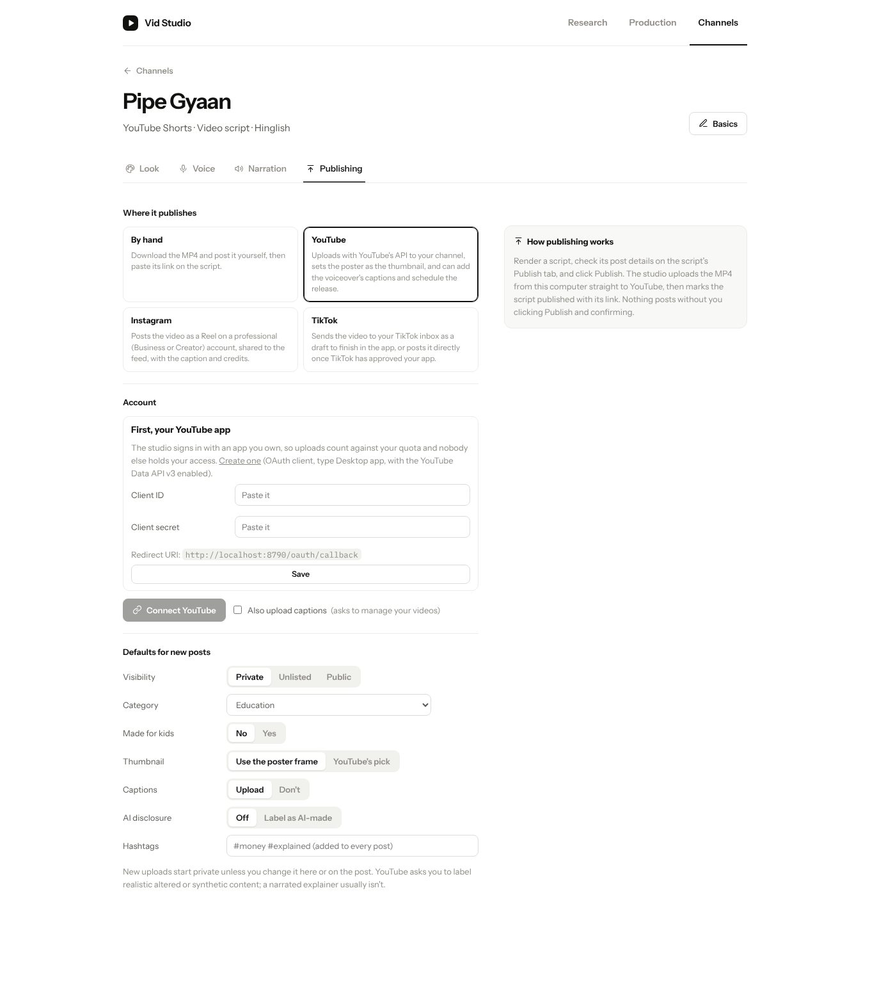
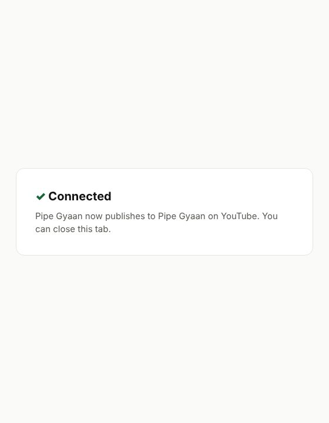
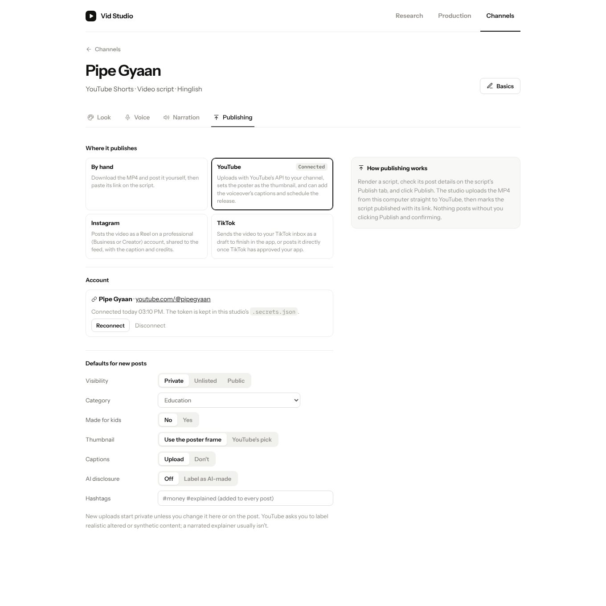
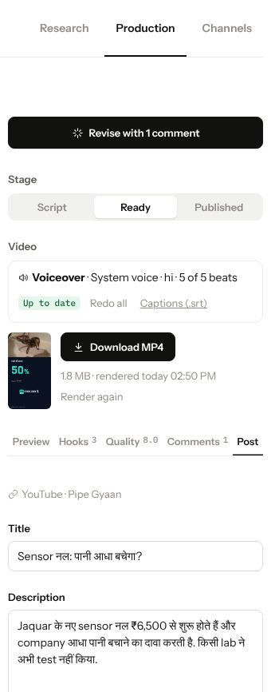
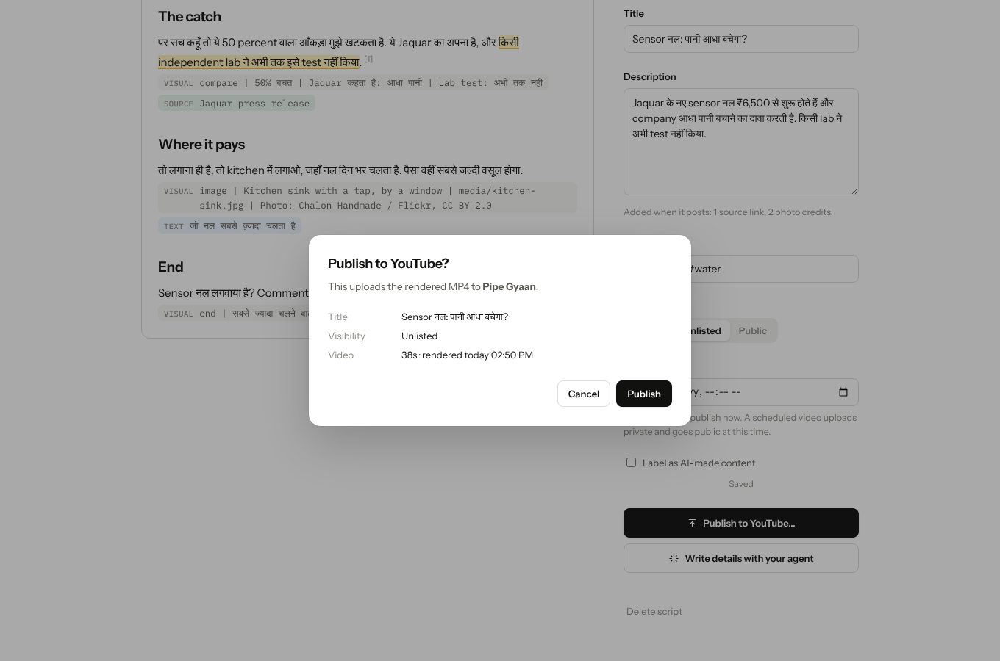
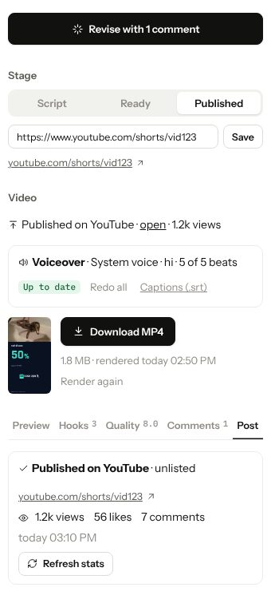
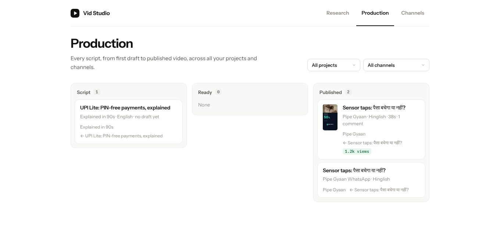

# Publishing to real channels

Channels were labels: a name, a platform string, a language and a look. Publishing meant downloading the MP4, uploading it by hand, and pasting the link back. This change connects a video channel to its real account and publishes from the script page: **YouTube** (Shorts and long-form), **Instagram Reels**, and **TikTok**.

## Why not social-sdk

[social-sdk.dev](https://social-sdk.dev) (as far as I can tell, the `@opencoredev/social-sdk` package on npm; the site itself didn't resolve from the development machine) is a well-designed TypeScript library: adapters per platform, explicit capabilities, typed outcomes. It needs Node 22.12+ and is ESM-only, and it's at v0.5. The studio is a Python standard-library skill that installs with no dependencies, so `scripts/publish.py` implements the three platforms itself, directly against their official APIs, borrowing the same shape: one adapter per platform with connect, refresh, account, publish and stats. Adding LinkedIn, X or Threads later is one class each.

## What it does

- **Connect.** YouTube and TikTok sign in in the browser with OAuth 2.0, PKCE and a loopback redirect to the studio (`/oauth/start` → the platform → `/oauth/callback`). The user brings their own Google Cloud or TikTok app, so uploads count against their own quota and no third party holds their access. Instagram connects with a token generated in the Meta app dashboard. Tokens live in `.secrets.json` (mode 600), refresh on their own, are never sent to the page, and are revoked on disconnect.
- **Post details.** Title, description or caption, hashtags, tags, visibility, release time (YouTube), "made for kids", and the platforms' AI/synthetic-content label. Channel defaults fill new posts, and the agent can write them (`studio.py publish-details`). When it posts, the studio appends the story's source links and the photo credits the CC licences require.
- **Upload.**
  - **YouTube:** a resumable upload in 8 MB chunks. If it stops midway, the next attempt asks YouTube how far it got and continues. Then the poster is set as the thumbnail and the voiceover's `captions.srt` is uploaded, and the video can be scheduled with `publishAt`.
  - **Instagram:** a Reels container with a resumable upload, polling until Instagram has processed the video, then publish, then fetch the permalink.
  - **TikTok:** an inbox draft by default (always allowed). Direct posting checks the creator's allowed privacy levels first, since unaudited apps may only post privately.
- **After.** The script moves to Published with its link. Views, likes and comments refresh on demand and show on the board.
- **Guard rails.** Publishing needs a current render, a connected account, and an explicit confirm (the API refuses `POST …/publish` without `{"confirm": true}`, the CLI without `--yes`). The agent's reference says to publish only when the user asks, for that script, and never from a scheduled run.

Every image below is the real studio UI. The platform APIs are faked by the same in-memory fake the tests use, which follows each platform's documented protocol, including YouTube's `308 Resume Incomplete`.

## Connect a channel

Channels → a video channel → **Publishing**. Pick the platform (it's guessed from the channel's platform name), add your app's credentials once, and connect.

The sign-in opens in a popup and lands back on the studio:

## Publish a script

The script's **Post** tab holds the details, saved as you type. Publish asks once more, with the account, visibility and release time:

The upload shows progress in the sidebar. When it's done, the script is Published with its link and stats:

## For agents

`references/publish.md` covers setting up each platform, `studio.py platforms`, `platform-app`, `connect`, `disconnect`, `publishing`, `publish-details`, `publish --yes` and `stats`, and how to write titles, descriptions and captions.

## Limits and what wasn't run live

- This machine's network can't reach the platforms, so no real upload was made. `tests/test_publish.py` runs each client against a protocol-level fake: OAuth code exchange and refresh, YouTube's resumable session with an interrupted upload resumed from the confirmed byte, thumbnail and caption upload, Instagram's container → upload → poll → publish, and TikTok's inbox and direct flows with privacy checks. The real Google sign-in URL was opened in a browser and Google recognised it as an OAuth request (it rejected the test client ID, as expected). A first live upload with a real account is the remaining check.
- YouTube keeps uploads from unaudited Google projects private, and its default daily quota fits about six uploads. TikTok direct posts are private until TikTok audits the app; drafts always work. Instagram and TikTok can't schedule through their APIs.
- WhatsApp channels have no posting API; text posts are still shared by hand.
