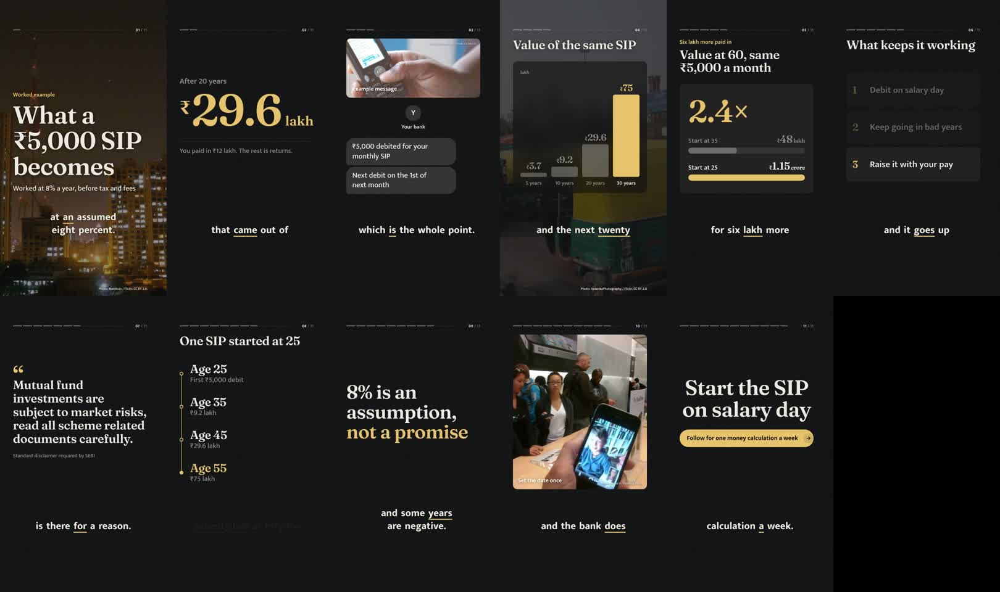
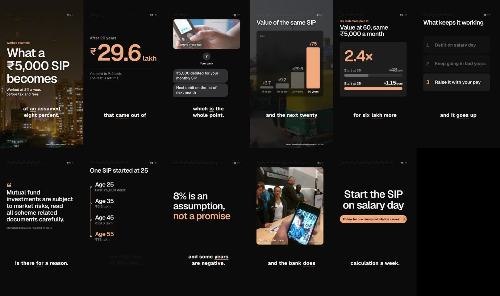
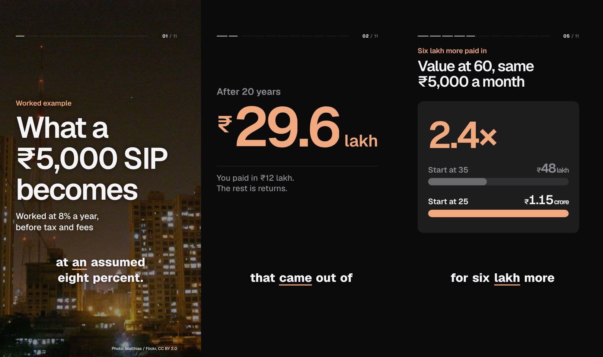
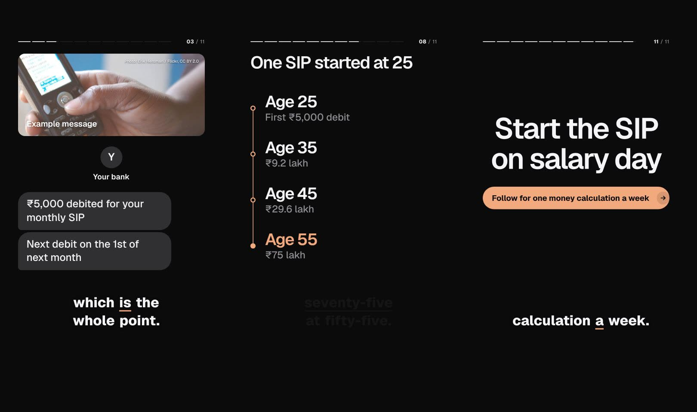
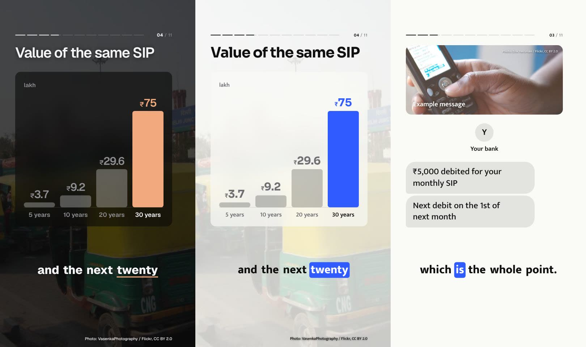
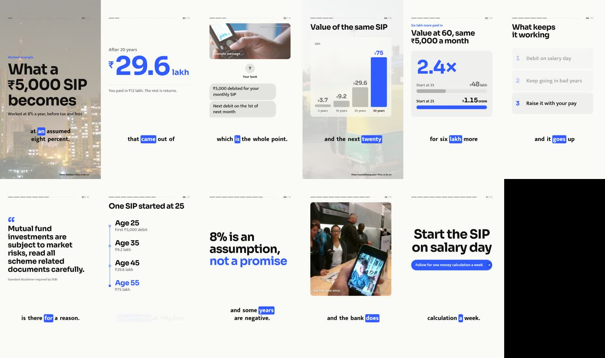
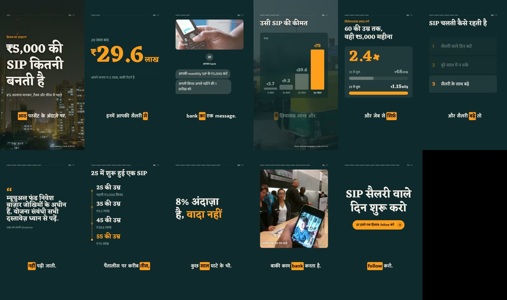
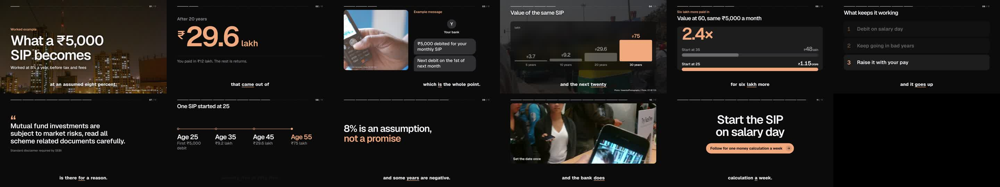

# Rounded tiles

The flat editorial scenes read as slides: a heading, a few lines of type and a lot of empty frame. Photos ran as hard-edged strips, or sat behind charts under a scrim that turned them to mud. This change gives every scene a component and every photo a frame, and keeps the flat look's restraint. It has no gradients, glows, shadows or blurred colour fields. It looks like a product film, not a template.

## Before and after

Night Edition, the same sample script, frame for frame. Before:

After:

Graphite, a new look: near-black, soft white, one warm accent, Geist throughout.

## What changed

**One tile per idea, and only where it helps.** Charts, list points and compare phrases sit on flat, rounded tiles, one step lighter (or darker) than the background. Scenes that read better as type on the background drop the tile: the stat, the quote, the timeline (dates as display type on a rail that draws through them), the message (a chat screen with the sender centred above the bubbles) and the end card (a centred finale).

The tiles:

- A chart sits on one tile.
- Each list point gets its own tile.
- Two phrases in a compare sit on two tiles, with a small arrow from the first to the second.

**Numbers are the hero.** A stat drops its tile, and the number is set as large as the frame allows. Its digits roll in like an odometer, with each column as wide as its final digit, so nothing shifts. A percentage up to 100 also fills a thin meter. A compare of two numbers leads with the difference between them (`2.4×`, `+38%`), with the two values as rows below on the same scale. A bar chart whose values share a unit ("lakh") shows it once, at the top.

**Labels are eyebrows.** `Text:` labels and kickers are small accent text in sentence case, not boxes. On a photo card the label sits on the photo's bottom-left corner, so the scene below keeps its full size.

**Photos.** A title's photo fills the frame under a light veil, with the title set large near the bottom, like the opening of a film. A photo above any other scene is a rounded photo card on the plain background. In the image scene the photo takes the whole space. Behind a chart, the photo fills the frame under a flat veil, and the chart's tile frosts the part it covers. That is the only blur in the system, and it is there so the values stay readable.

**Motion.** Tiles rise a short way and settle on a long ease, and fades lift slightly as one scene hands over to the next. List points arrive across the whole beat, and the earlier ones step back as each new one lands, so the eye is always on the point being spoken. The progress line is quieter: the beats still to come are barely there. Nothing bounces, and holds stay still.

**Fixes.** The scene counter ("11 / 11") no longer sits on the progress line. A photo credit with no source beside it is no longer cut off. Text inside tiles is sized for a phone.

Rendering costs about 66 ms a frame, against 61 for the old flat look.

## It works in every look

Light (Studio White):

Hindi (Monsoon):

Wide (Graphite at 16:9):

## Settings

- `cards.style` takes `glass` (the default), `solid` or `flat`. `glass` gives tiles one step off the background, frosted over photos. `solid` fills the tiles with `surface`. `flat` is the old editorial look, with no tiles. In the studio it's under Channels → a channel → Look → Background & shape → Cards.
- `radius` is now the tile radius, and bars and buttons scale from it. The default is 28.

Presets: Graphite is new. Most presets use tiles with a radius of 22 to 34, and keep their original backgrounds. Clean Newsroom and Paper Notebook use solid tiles. Swiss stays flat, so the editorial look is one click away.
