# Scene design, captions, looks and script content

The rendered scenes looked templated and AI-made. Headings sat at a different height in every scene, and charts were small and crammed under their titles above a band of empty space. Source tags floated mid-frame. Captions looked like part of the graphic. Gradients and glows were everywhere. The scripts read like a model wrote them: slogans, fragment chains, a misattributed quote, and a maker's claim charted as invented numbers.

Each sheet shows one settled frame per scene, rendered by the real engine at 1080×1920.

## Before and after

### Hinglish demo (`dev.py demo`, Night Desk)

Before:

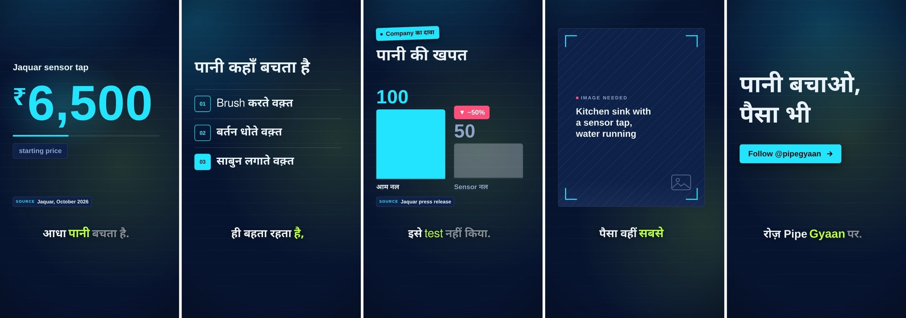

After:

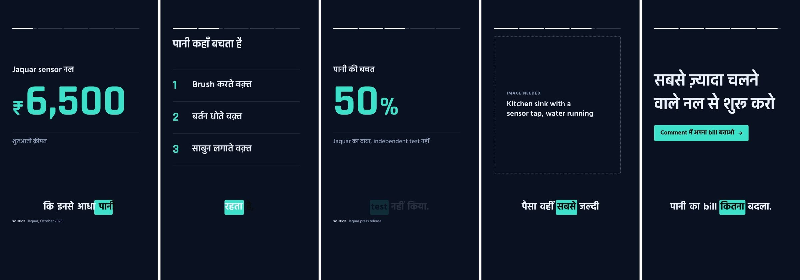

### English example (`english-60s.md`, Bold Explainer)

Before:

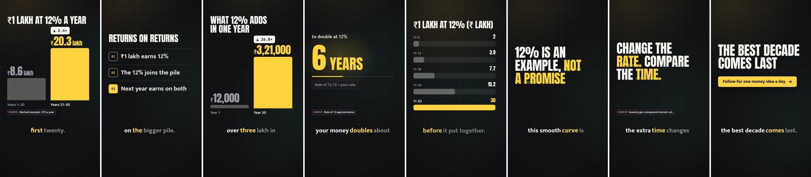

After (rewritten script):

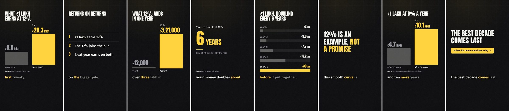

### An agent-written script, unchanged (Data Noir)

The text is exactly what the agent wrote, so the difference comes from the engine alone. Its script still has lines like "Until it doesn't." and "Follow to keep up with AI news"; `studio.py scenes` now flags both.

Before:

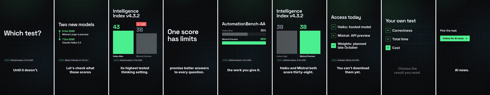

After:

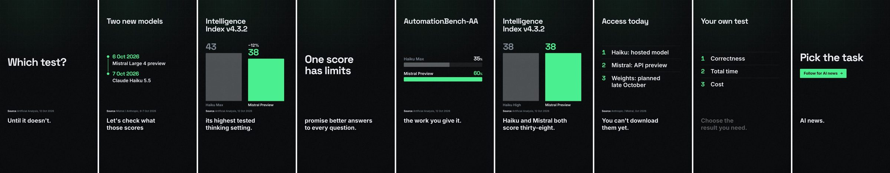

### Hinglish example in the new Monsoon look

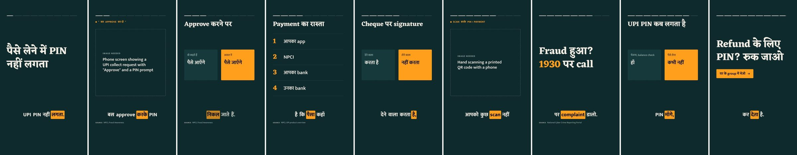

## Captions that follow the voice

Captions are centred and heavy, in their own band, so they read as captions rather than as part of the graphic. In the new default style, `highlight`, a pill in the accent colour sits behind the word being spoken and jumps word to word with the voiceover. Every frame shows it on exactly one word.

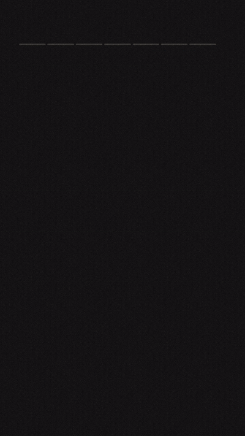 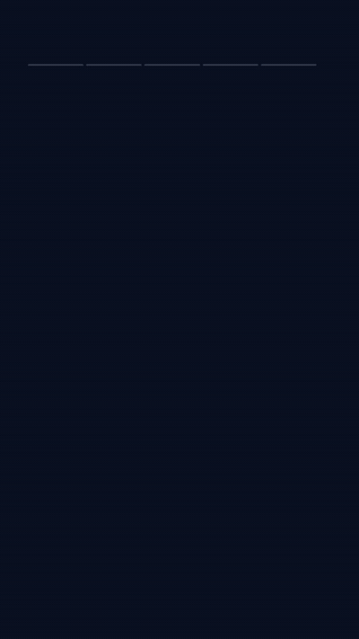

## Ten looks

Every preset is redesigned with its own palette and type pairing, and there are two new ones: **Monsoon** (deep teal, saffron, and Eczar, an expressive Devanagari serif) and **Studio White** (gallery white, electric blue, Sora). The looks use flat colour with no glows, sentence-case headlines, and one accent for the thing that matters in each scene. Night Desk, the default for Hindi and Hinglish channels, uses Devanagari-capable display and body fonts.

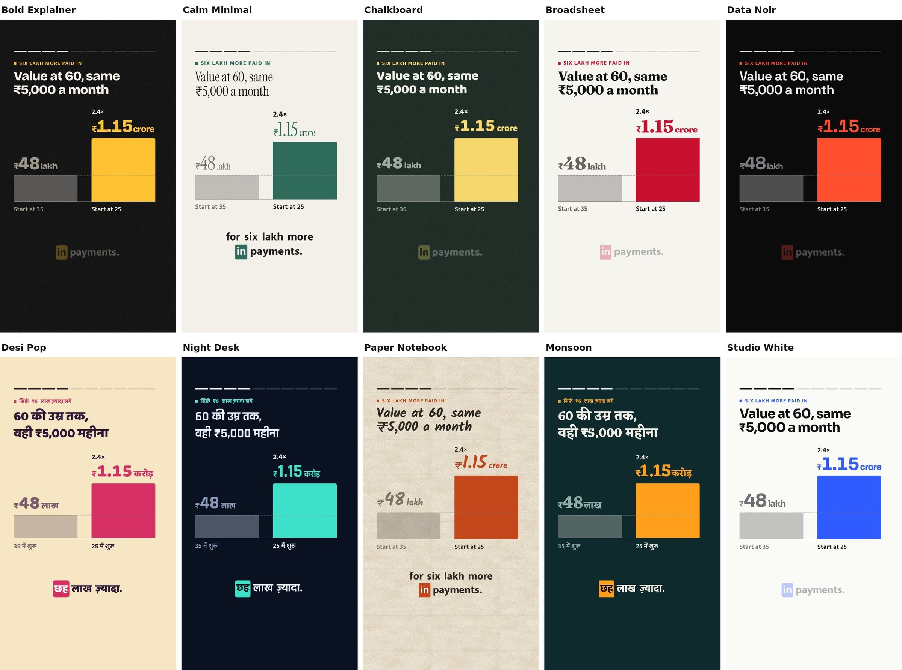

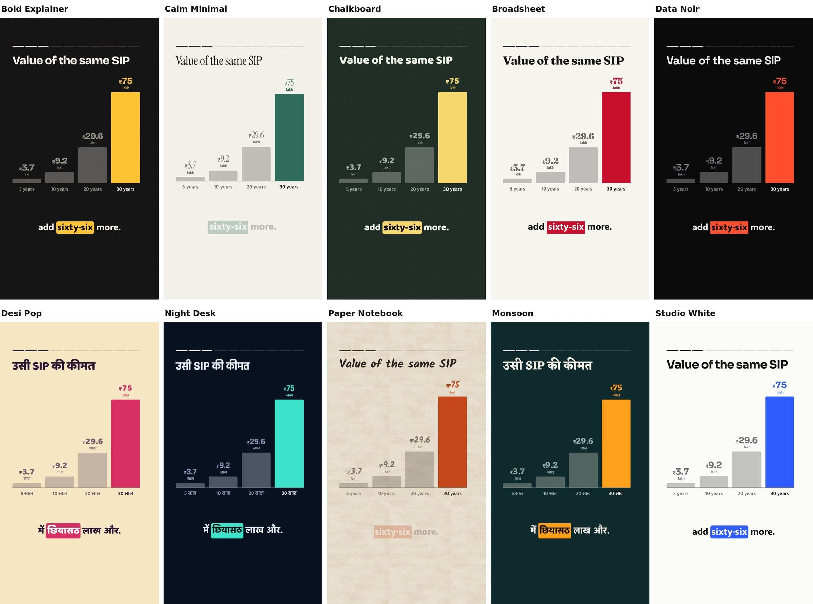

## The empty band at the bottom is on purpose

The bottom 20% of a 9:16 frame sits under the platform's own interface: the channel name, the title and the buttons. Nothing important goes there. Captions sit just above that band. The source line is small print on the frame's bottom edge, under the interface, where it's on record without competing with the content.

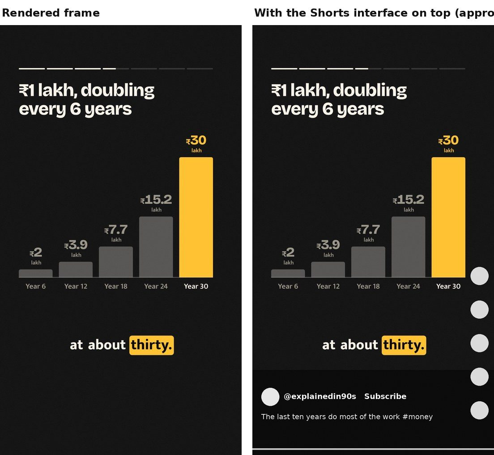

## What changed

**Layout**
- A thin progress line at the top, one segment per beat, fills as the voiceover plays (`progress.show`).
- The `Text:` label and the chart title share a header row in the same place in every scene. Headings keep one size across scenes.
- Charts, lists and timelines fill the space under the header instead of huddling under the title. A stat, punchline, quote or end card is centred in that space. Short punchlines ("50 · 30 · 20") are set poster-size.
- The source and photo credit are one line of small print on the very bottom edge of the frame, in the same place every time.
- Captions are centred on the canvas, clear of the side buttons, and bottom-anchored in their band.

**Charts**
- `bars` with short labels (years, steps) draws a column chart with a baseline, with values above the columns at one shared size. Longer labels draw horizontal rows that spread over the height.
- `compare` draws its second item as the subject in the accent, adds a dashed reference line that carries the first value across, and puts the change (`2.4×`, `−50%`) above the subject's value. Two phrases draw panels; the subject panel is filled with the accent.
- `list` uses large display numerals with dividers above and below. `timeline` spreads its events with the line running through the dots.
- `stat` has a divider before its context line.

**Style**
- No gradients, glows, vignettes or moving colour blobs. `gradient` is now a barely visible tonal step, and no preset uses it. Patterns are off in every preset except Paper Notebook's ruled lines.
- Photo scrims are flat tints.
- Holds are still, transitions are short, and nothing rotates.

**Content**
- All three bundled examples, the demo script and the live-preview sample (`sample.json`) are rewritten. The sample used to promise money that "could quietly turn into lakhs" and quoted Einstein on compound interest, a quote with no evidence he said it. It is now real SIP arithmetic, and its quote is SEBI's actual mandatory disclaimer.
- `script-craft.md` adds aphorisms, borrowed wisdom, soft hype, teaser twists and generic sign-offs to its machine-made patterns, plus a section on on-screen text.
- `studio.py scenes` now lints the voiceover as well as the screen. It flags phrases like "Here's why", "Until it doesn't", "Let's check", "Follow for more" and "दोस्तों", and chains of three or more fragment sentences. It still flags repeated headlines, more than two `text` scenes, bars without numbers, a compare that mixes a number and a phrase, and unitless chart values. The tests check that the examples produce no warnings.

## Checks

```sh
VID_STUDIO_RENDER_TEST=1 python3 -m unittest discover tests
node tests/test_engine.js
node tests/test_ui.js
```
