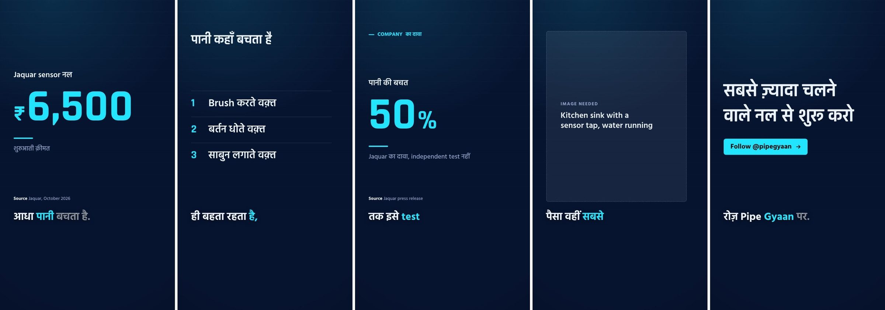

# Scene design and on-screen content

The rendered scenes looked templated: headings started at a different height in every scene, captions were centred while the graphics were left-aligned, and decoration stood in for information (a glow behind numbers, a progress bar that measured nothing, tilted pills, pulsing rings, drifting colour blobs). The on-screen text was weak too: slogans on most scenes, the same line twice, and a maker's claim charted as invented "100 vs 50" values.

Each sheet shows one settled frame per scene, rendered by the real engine at 1080×1920.

## Hinglish demo (`dev.py demo`, Neon Finance)

Before:


After:



## English example (`english-60s.md`, Bold Explainer)

Before:


After:


## An agent-written script, unchanged (Data Noir)

This script was written in the sandbox before this change. Its text is unchanged, so the difference comes from the engine alone.

Before:


After:


## What changed

**Layout.** Every scene sits on one grid. The `Text:` overlay and a chart's title share a header row pinned to the top of the content area, and the visual is centred below it. Captions, sources and graphics share one left edge, and a caption's first line is always in the same place. Headings keep one size across scenes; only the visual shrinks to fit.

**Motion.** Holds are still. Previously the frame, titles and numbers slowly scaled up, which moved their edges off the grid. Entrances stay, with smaller transition distances and no rotations.

**Decoration removed.** The stat's halo and fake progress bar, the bar-chart shine, the boxed list numbers, the tilted overlay pill, the CTA pulse ring, the moving background blobs and the "scanner" image placeholder are gone. The overlay is now a quiet accent label, and the source tag is a plain line of small print.

**Captions.** Karaoke no longer scales the spoken word. Scaling ate the spaces beside it ("कोईindependenttest"). The pop style no longer colours every third chunk. Neon Finance highlights captions in its main accent rather than a second, competing lime.

**Compare.** The second item is the subject and takes the accent, so "आम नल vs Sensor नल" no longer highlights the ordinary tap because its number is bigger. Two phrases (rather than two numbers) draw side-by-side panels instead of meaningless equal bars. The change label is plain text ("−50%", "2.4×").

**Content.** `script-craft.md` §6 has a new *On-screen text* section: every scene shows a fact, not a mood; at most two `text` scenes; never repeat a headline; chart only measured or calculated numbers, with units; plain sentence-case titles. Two new machine-made patterns (teaser twists, generic sign-offs) join the §5 table. `studio.py scenes` now warns about repeated headlines, more than two `text` scenes, bars without numbers, a compare mixing a number and a phrase, and unitless chart values. The three examples and the demo script are rewritten to pass. The tests check that the examples produce no warnings.

## Checks

```sh
VID_STUDIO_RENDER_TEST=1 python3 -m unittest discover tests
node tests/test_engine.js
node tests/test_ui.js
```
