# A calmer, more professional studio, and your own voice

Two changes. The studio's interface is now a proper app: a sidebar, a quieter type scale, one neutral palette with one accent, and a dark mode. And the voiceover can now be **you**: record or upload a take for any beat, make "Your voice" a channel's narrator, or clone your voice with ElevenLabs so the narrator sounds like you.

Every image is the real studio, captured in Chromium. "Before" is this branch's parent (namanbnsl/vid-studio#5); "after" is this branch.

## The interface

- **App shell.** Research, Production and Channels move to a left sidebar, with the project list under Research, then voice-provider keys and a light/dark/system switch at the bottom. On a phone the sidebar becomes a single top bar.
- **Quieter hierarchy.** Page titles go from 34px to 24px, body text from 14px to 13.5px, and section labels are lighter. Pages lead with their content instead of a large headline.
- **Lists as one surface.** Topics, sources, findings, stories and channels are one bordered group with hairlines between rows, not a stack of separate cards. A selected finding gets a tinted row and an accent bar.
- **One system of tokens.** Every colour is a variable: a neutral scale, one indigo accent for focus and selection, and success/warning/danger tints. Buttons, inputs, selects and segmented controls share one height, radius and focus ring. Dialogs get a footer bar for their actions.
- **Dark mode** follows the system, or is set from the sidebar and remembered in this browser.
- **Production board.** Each column has a status dot (grey script, amber ready, green published), and the cards sit on a quiet well.

### Research

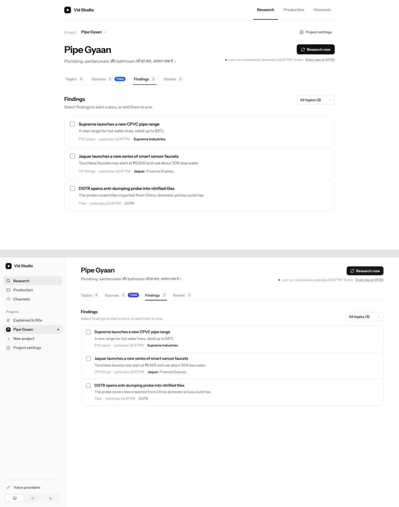

### Production

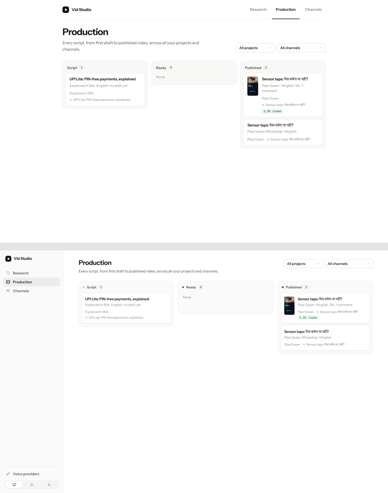

### Channels

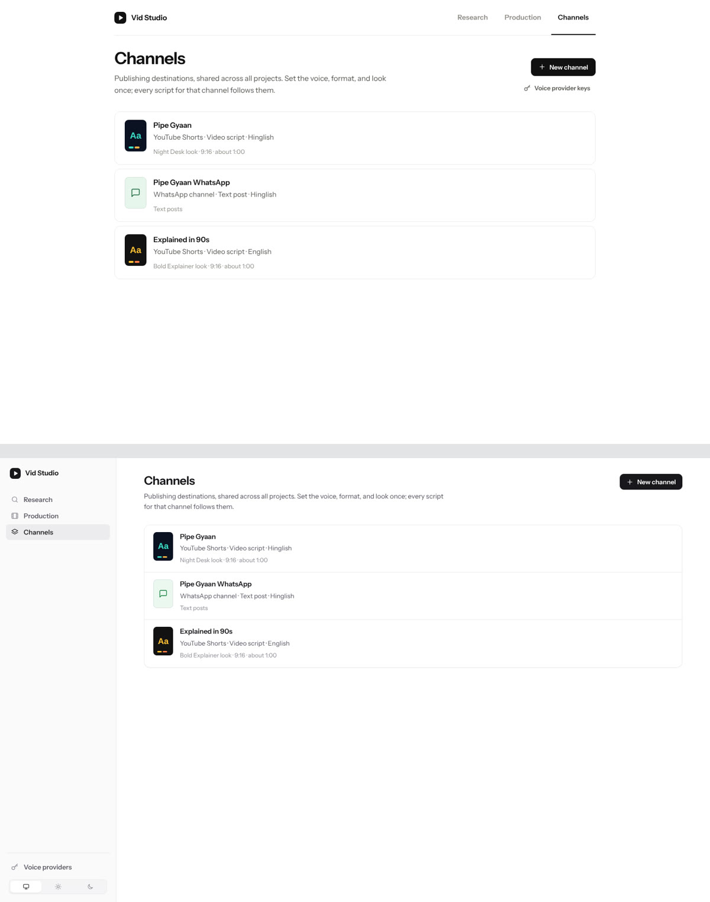

### Channel narration

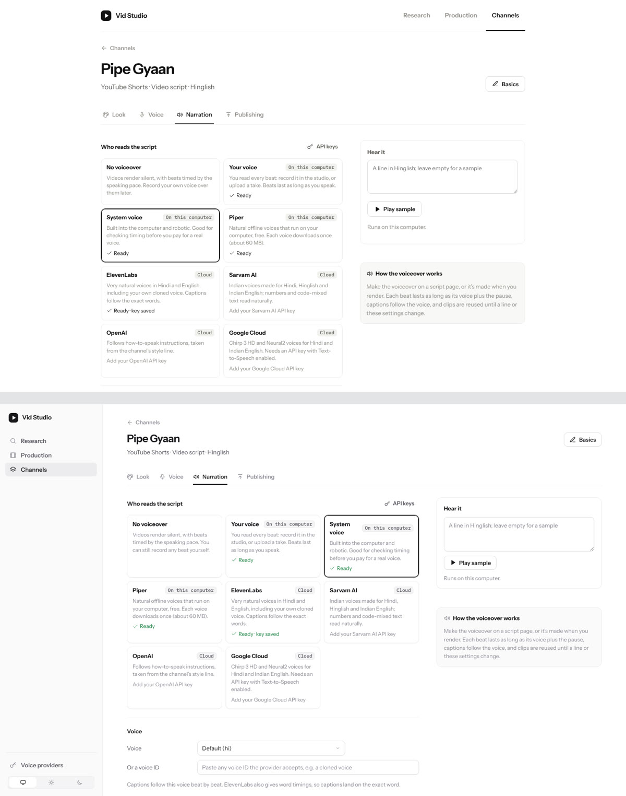

### Script page

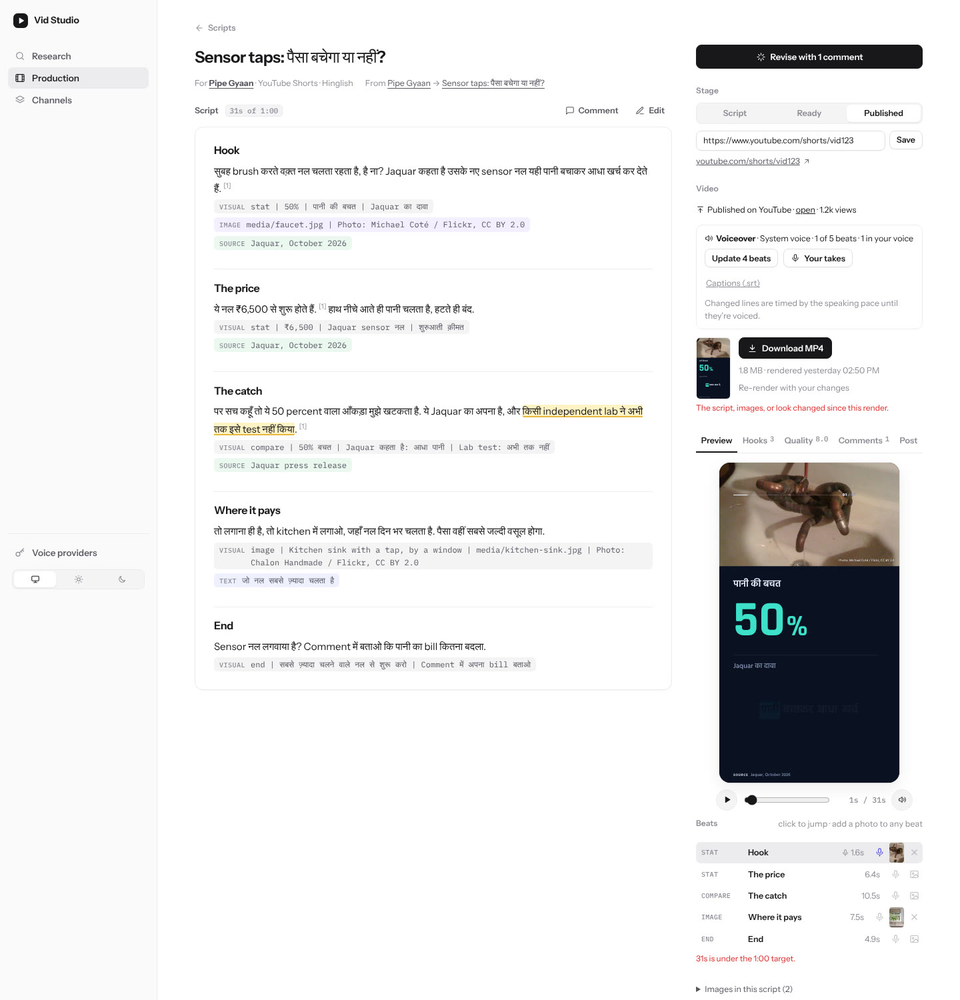

### Dark mode

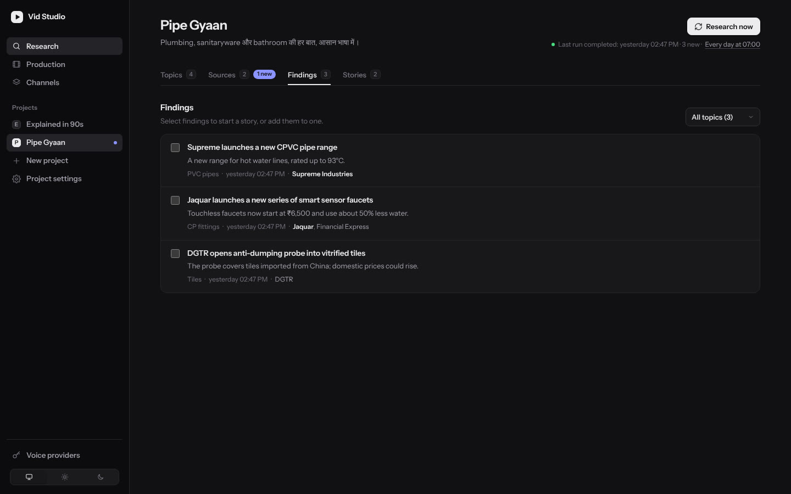

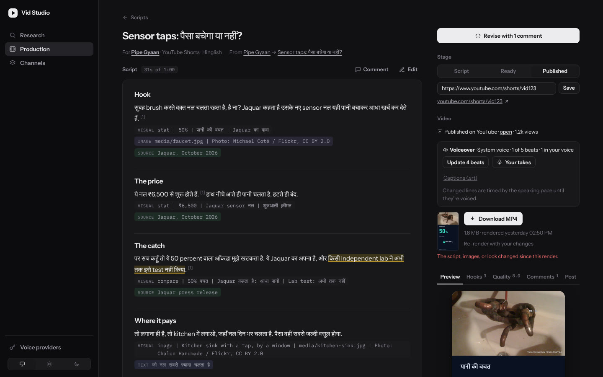

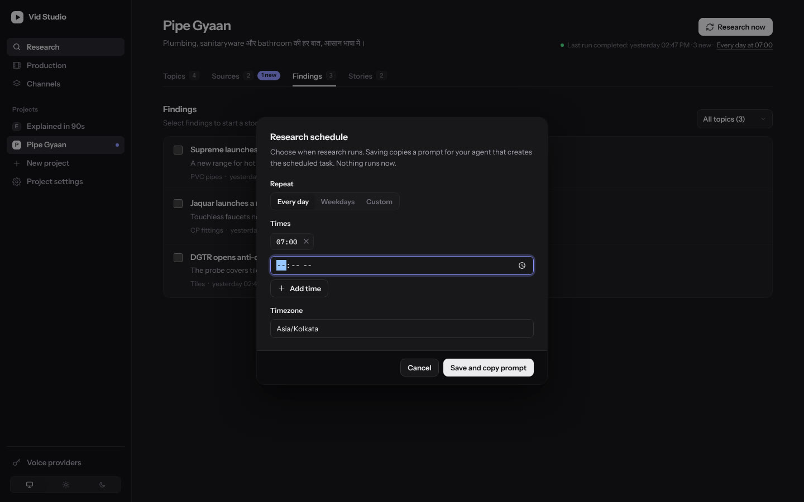

### Phone width

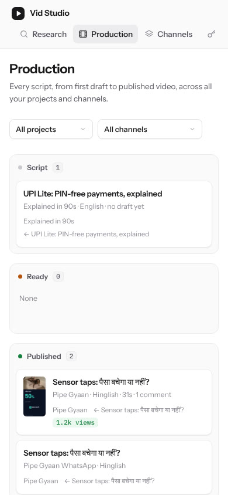

## Your own voice

### Record or upload a take for any beat

On a script, **Record it yourself** in the Video box (or the mic on any beat) opens a teleprompter:

- It shows each beat's line, with its `Say:` text when there is one.
- Record, watch the level meter, listen back, then **Keep** or **Redo**. Keyboard: <kbd>Space</kbd> record, <kbd>Enter</kbd> keep, <kbd>←</kbd> <kbd>→</kbd> move between beats.
- It moves to the next beat on its own, and you can upload a file instead.

On the server, each take is converted to 48 kHz mono WAV (ffmpeg), low rumble is filtered out, and silence is trimmed while keeping a breath at each end.

A take always wins over the channel's narrator for that beat, even when the channel has no narrator. The beat lasts as long as you speak, and the render mixes it in like any other clip. A take belongs to the words it reads, so when you rewrite a line, the beat asks for a new take. Agents can do the same from the CLI: `studio.py take --script S --beat 2 --file take.m4a`.

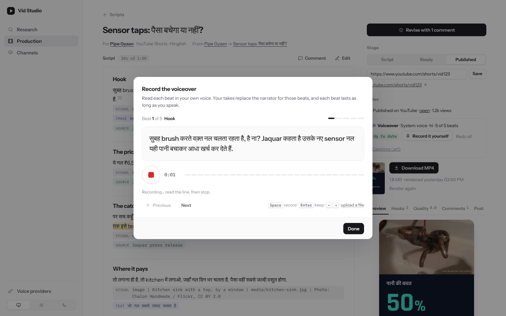

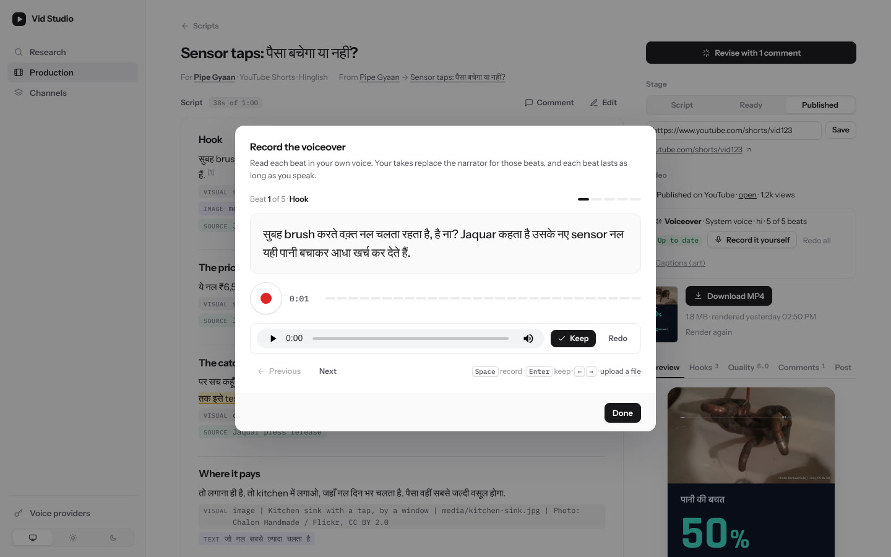

### "Your voice" as the narrator

A new narrator, **Your voice**, means you read every beat. The studio never synthesises anything for that channel: the script page asks for takes, rendering leaves unrecorded beats silent, and `narrate` lists the beats still waiting for you.

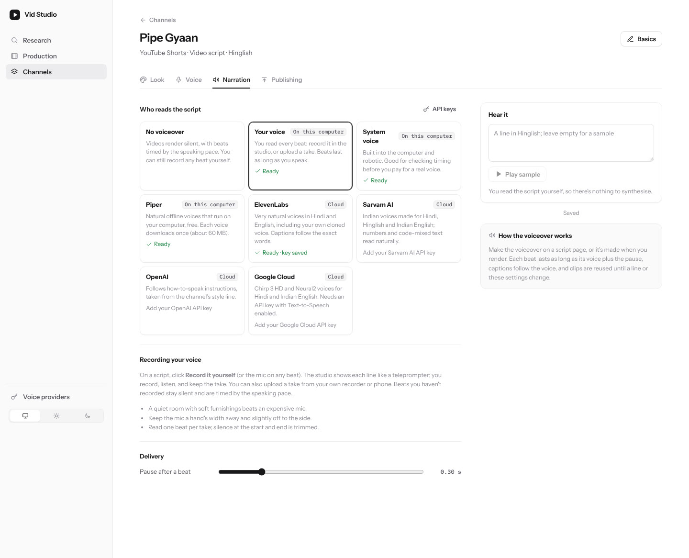

### Clone your voice (ElevenLabs)

With ElevenLabs as the narrator, **Clone my voice…** opens a recorder with a passage to read in the channel's language; you can also upload samples. The studio converts the samples and checks there are at least 30 seconds. With your consent (a checkbox), it creates an ElevenLabs instant voice clone and makes it the channel's voice. The samples are kept in `channels/<id>/voice-samples/`.

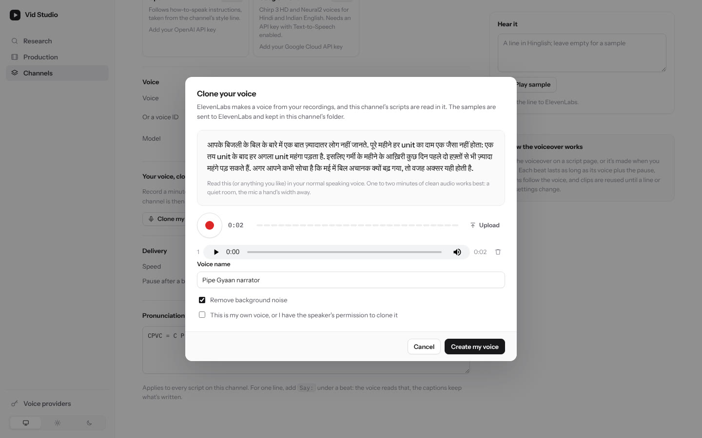

## Checked

- 76 Python tests (1 skipped) and 37 Node tests. New tests cover:
  - takes overriding the narrator, with or without one;
  - Say: takes, silence rejection, deletion;
  - the Your voice narrator never synthesising;
  - real ffmpeg conversion of an Opus/WebM take;
  - the `take` CLI;
  - the ElevenLabs clone request (multipart fields, both files, voice set on the channel, consent and minimum-length checks);
  - the HTTP endpoints;
  - browser/server timing parity with takes.
- In Chromium, with its fake microphone: record, stop, listen, keep. The server stored the take and the beat was re-timed, with no console errors.
- Not run live: an actual ElevenLabs clone. The container can't reach ElevenLabs, so the request is checked against their documented `POST /v1/voices/add`.
