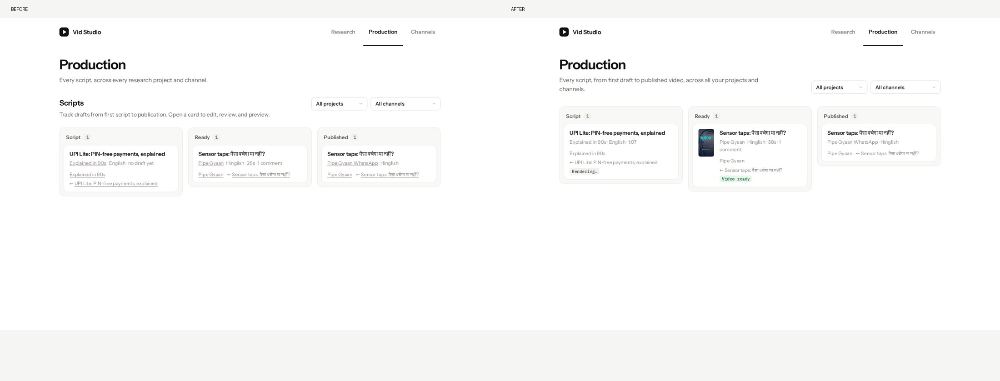
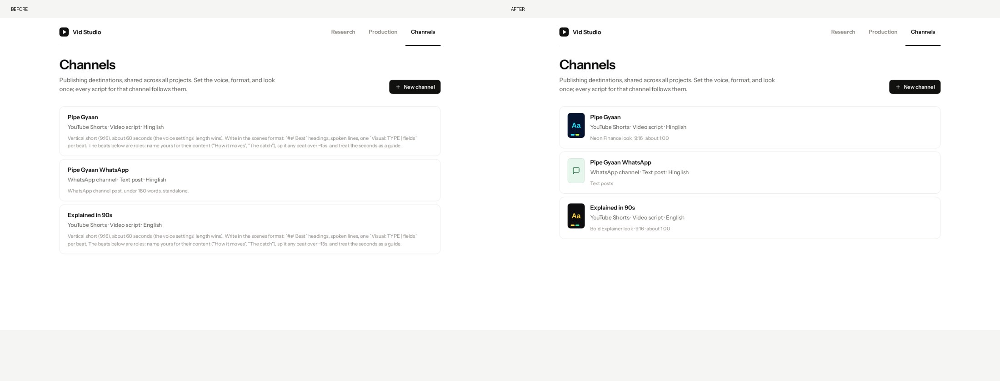
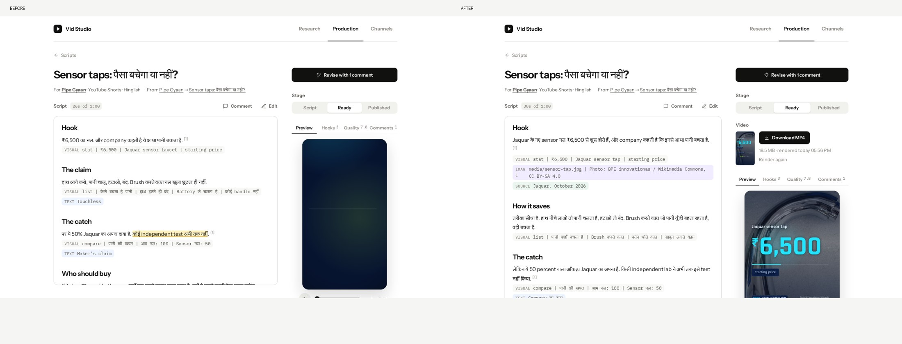
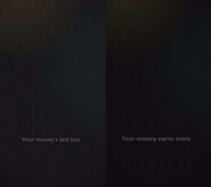
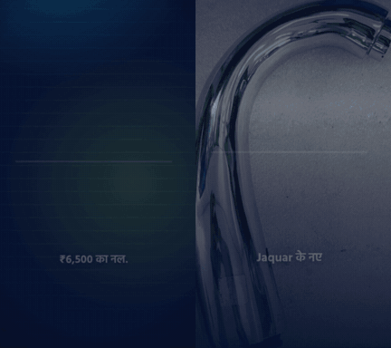
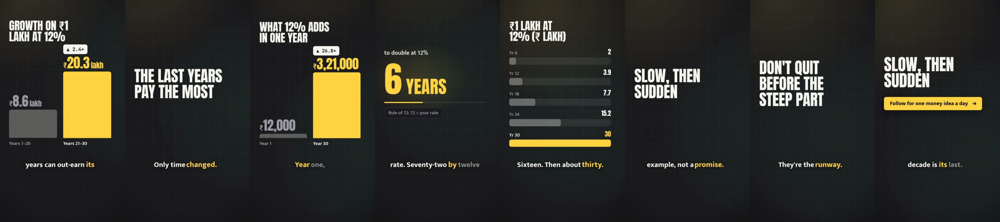
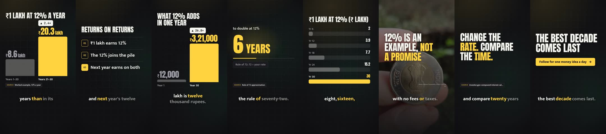
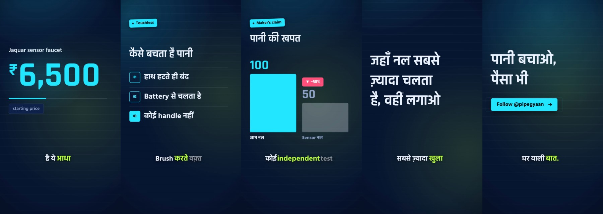
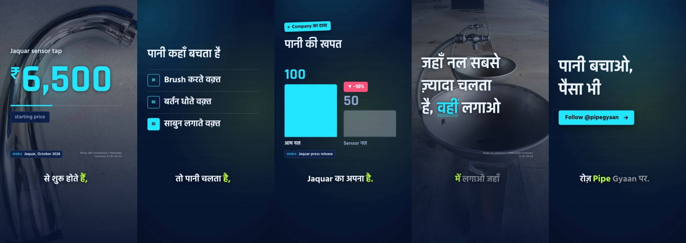
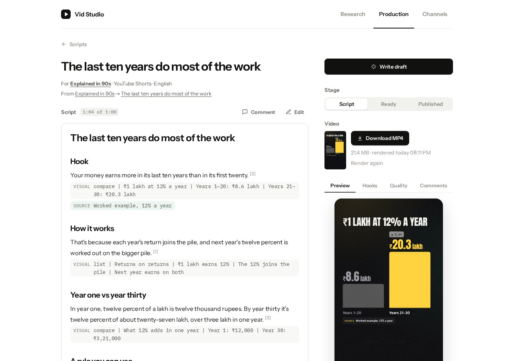

# Video quality: before and after

The comparisons below use the scene engine and UI from `47e419f` as the before state, after committing the work that was already in progress. The PR also includes the earlier production work that has not yet reached `main`.

## What changed

| Area | Before | After |
| --- | --- | --- |
| Production | Repeated headings, crowded source labels, no render status | One heading, compact source links, posters and video status |
| Channels | Format instructions shown in channel lists | Color and typography swatches, aspect ratio and target length |
| Script editor | Small preview, nested scrolling, narrow sidebar tabs | Larger preview, full script preview, readable tabs and cue labels; hidden planning comments |
| Pictures | Image placeholders and remote image URLs | Script-local JPEG/PNG/WebP files, per-beat upload, licensed photo search, import of images generated by the host agent |
| Video | HyperFrames export only | Background local MP4 rendering, progress, download, stale-video detection and actionable failures |
| Customization | Existing colors, fonts, motion and caption styles | Photo treatment, caption size, source tags and per-beat duration overrides |
| Writing | Short fragments and generic transitions | Connected explanation, worked examples, concrete viewer value, read-aloud revision and stronger naturalness/value review |

## UI comparisons

Before is on the left; after is on the right. These are saved snapshots of the same seeded demo pages from the implementation session.

### Production



### Channels



### Script editor



## Motion comparisons

Before is on the left; after is on the right. The first 6.5 seconds show the changed script, caption rhythm and photo integration. These clips demonstrate the features; the plumbing story is fictional demo data, not researched product reporting.

### English hook



The same compound-interest example now uses connected sentences and demonstrates the mechanism rather than relying on fragment chains. The final example adds explicit assumptions, fees/tax exclusions and a calculator exercise instead of treating a smooth return curve as an investment forecast.

### Hinglish hook



The hook puts a real sensor-tap photo behind the price. That photo illustrates the category; it is not evidence of a particular brand or model.

## Scene sheets

### English: before



### English: after



### Hinglish: before



### Hinglish: after



## Download and image workflow

Open a video script, click **Render MP4**, wait for progress to finish, then click **Download MP4**. The render is local, at 1080p and 30 fps, using an installed Chrome/Chromium and ffmpeg. macOS and Linux are supported; Windows users can use WSL. The previous video survives a failed render, and edits to the script, images or channel look mark it as outdated.



The equivalent CLI is:

```sh
python3 skills/vid-studio/scripts/studio.py --workspace ~/vid-studio --project PROJECT render --script SCRIPT --out ~/Desktop
```

Search with `studio.py images "sensor tap" --preview /tmp/vid-images`, inspect the candidates, then use `studio.py media --script SCRIPT --add FILE_OR_URL --credit "…" --source PAGE --license "…"`. The agent can import a file made by its image-generation tool through the same command. Reference the saved path with `Image: media/photo.jpg | credit`; `Visual: image | description | media/photo.jpg | credit` makes it a full photo scene.

Voice, TTS and music remain deferred, as requested. The preview and rendered examples are silent. GSAP and web fonts currently load from CDNs; render errors and font fallback are surfaced rather than promising fully offline output.

## Validation

- 36 Python tests pass with the opt-in render test enabled, including web API, media export, parser parity and render lifecycle checks.
- 34 JavaScript tests pass across UI persistence/navigation, media cues, planning comments, engine normalization, font loading and player behavior.
- The real background integration render includes an embedded PNG. ffprobe verifies H.264, 720×1280 and the script's 3.5-second duration. Removing the image reports a render failure and preserves the previous MP4.
- A full English example is rendered through the UI at 1080×1920, 30 fps, then downloaded through the browser.
- The final English example lasts 63.5 seconds, renders in 174 seconds on the review machine and downloads as a 21.4 MB MP4. Performance depends on the machine, scene design and image complexity.
- Desktop and 390-pixel mobile script layouts are checked in the collaborative browser.

Run the checks with:

```sh
VID_STUDIO_RENDER_TEST=1 python3 -m unittest discover tests
node tests/test_ui.js
node tests/test_engine.js
git diff --check
```

## Photo attribution

The photos are cropped, dimmed and overlaid with graphics in the comparisons. Photo-containing comparison assets are shared under [CC BY-SA 4.0](https://creativecommons.org/licenses/by-sa/4.0/); the source photographs retain their original licenses.

- [New 20 Indian rupee coin 2021](https://www.flickr.com/photo.gne?id=51768223690), Lifetime Travelmates / Flickr, [CC BY-SA 2.0](https://creativecommons.org/licenses/by-sa/2.0/).
- [Sensor Tap](https://commons.wikimedia.org/wiki/File:Sensor_Tap.jpg), BPE innovationas / Wikimedia Commons, [CC BY-SA 4.0](https://creativecommons.org/licenses/by-sa/4.0/).
- [Water tap round sink](https://commons.wikimedia.org/wiki/File:Water_tap_round_sink.jpg), Dr. Chinchu C. / Wikimedia Commons, [CC BY-SA 4.0](https://creativecommons.org/licenses/by-sa/4.0/).
