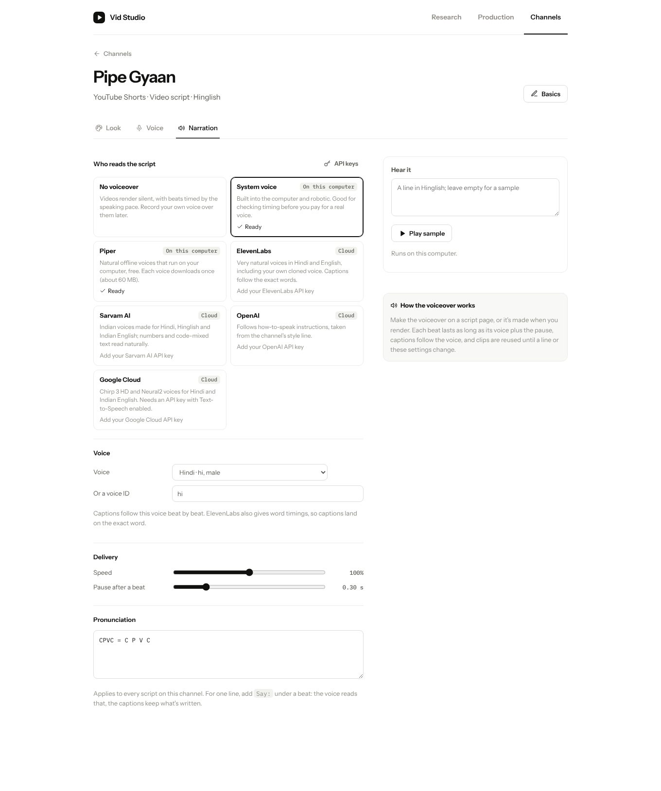
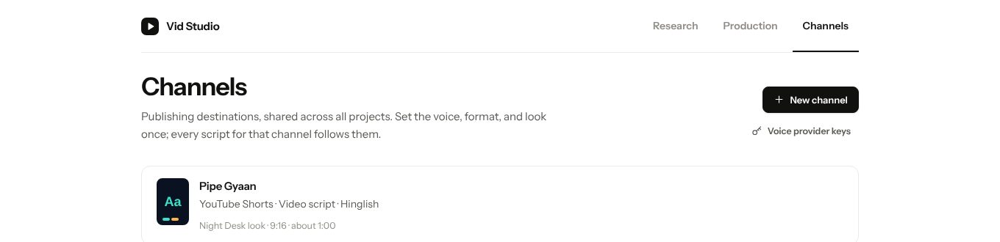
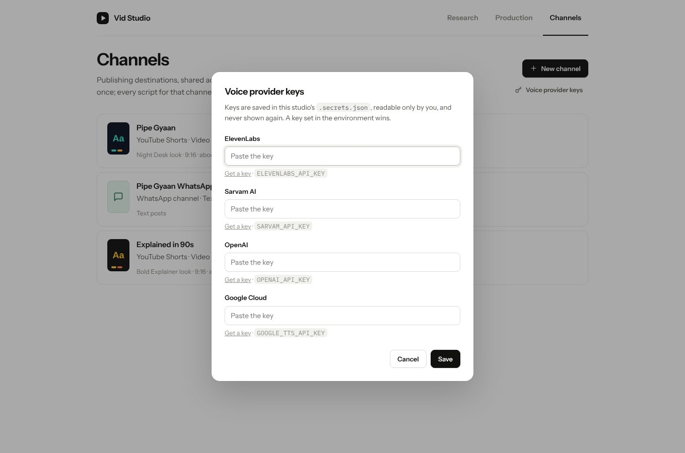
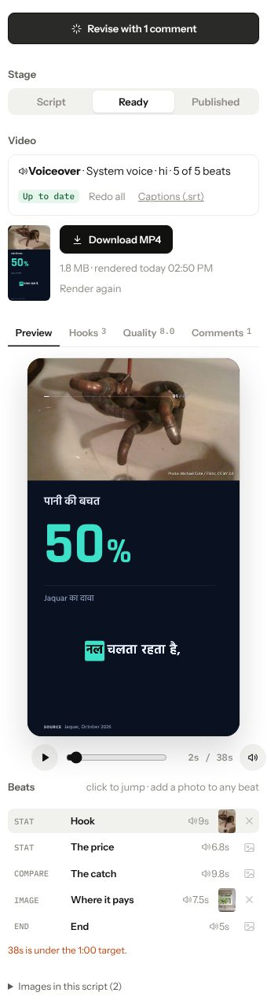
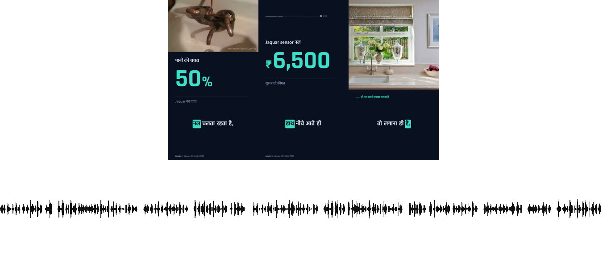

# Voiceover

Until now every video rendered silent: the MP4 carried an empty audio track, and each beat's length was a guess from its word count and the channel's speaking pace. This change gives a video channel a **narrator**, a text-to-speech voice that reads its scripts, and makes that voice the clock the video runs on.

- **One interface, many providers.** `scripts/narration.py` (standard library only) puts every engine behind the same three calls: is it ready, list its voices, speak this line. Two run on your computer: the system voice (`say` or `espeak-ng`), and free offline [Piper](https://github.com/OHF-Voice/piper1-gpl) voices. Four are cloud services you use with your own key: ElevenLabs, Sarvam AI, OpenAI and Google Cloud. Each one returns 16-bit WAV, so trimming, joining and timing need no extra tools. Adding a provider is one class.
- **Chosen per channel, later.** Nothing changes until you pick one. The Pipe Gyaan channel can read in Sarvam's Anushka while the English channel uses ElevenLabs, and switching costs nothing but a re-record.
- **The voice sets the timing.** Each beat is recorded on its own and lasts as long as its clip plus a pause you choose. Captions follow the voice, word by word with ElevenLabs, which reports when each word lands. Clips are cached by what was said and how, so a revision re-records only the beats it touched.
- **Written for the eye, said for the ear.** A new `Say:` cue lets the voice read "साढ़े छह हज़ार रुपये" while the captions show ₹6,500. A per-channel pronunciation list handles words that recur ("UPI = U P I").
- **In the MP4.** Rendering records any missing beats first, mixes the clips into one track normalised to about −16 LUFS (what phones and Shorts expect), and muxes it instead of silence. Every render also writes `captions.srt`, ready for YouTube.

Every image below is from the real studio and renderer, using the demo's Hinglish script and the free system voice (espeak-ng). It is robotic, but it shows the timing and the plumbing with no key.

## Pick who reads the script

Channels → a video channel → **Narration**. Providers say whether they're ready on this machine and what's missing (a key, or a tool to install). Pick a voice, hear a sample in the channel's language, and set the speed, the pause after each beat, and pronunciations.

Keys live in the studio's `.secrets.json`, readable only by you, and are never sent back to the page. A key set in the environment (`ELEVENLABS_API_KEY`, `SARVAM_API_KEY`, `OPENAI_API_KEY`, `GOOGLE_TTS_API_KEY`) wins.

## Make the voiceover

On a script, the Video box shows how many beats are voiced, with **Make voiceover**, **Update n beats** after edits, **Redo all**, and the captions file. Beats timed by the voice show a speaker icon, the preview plays the voiceover in sync (with a mute button), and the total is the real length.

## The render

Three frames of the rendered MP4 and its soundtrack. Each burst is one beat's clip, placed at the start of its beat, with the pause between them.

## For agents

`references/narration.md` covers choosing a provider, keys (`studio.py voice-key --provider P --key -`), `studio.py narration`, `voices`, `say`, `narrate` and `captions`, and when to write `Say:`. `studio.py scenes` now marks voiced beats and warns when a fixed `Duration:` would cut a voice off.

## Not covered here

- Live calls to ElevenLabs, Sarvam, OpenAI and Google were not made from the development machine (its network blocks them). Their request and response handling is tested against each provider's documented API with the HTTP layer faked. The system voice and the full render were run for real.
- Background music and ducking, per-beat voice changes (two speakers), and voice cloning from the studio itself are left for later. Cloned ElevenLabs voices already work: paste the voice ID.
